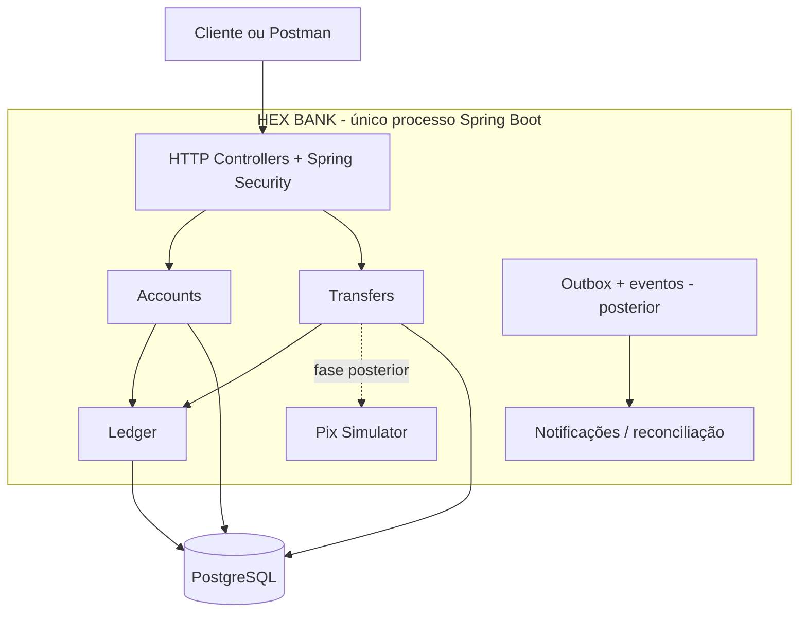

# HEX BANK

> Laboratório educacional de engenharia financeira em **Java + Spring Boot**, iniciado como **monólito modular** com arquitetura hexagonal. Não é um banco real, não movimenta dinheiro real e não oferece integração direta autorizada ao SPI.

## Missão
Construir um sistema pequeno com **corretude sob falhas**, priorizando integridade contábil, idempotência, concorrência e evidências automatizadas. Estudar padrões distribuídos gradualmente, **sem começar por microsserviços**.

## Princípios inegociáveis
1. Uma aplicação implantável inicialmente; módulos isolados por contratos explícitos.
2. Domínio Java independente de HTTP, Spring, JPA, Redis e broker.
3. Dinheiro por `Money` com moeda e unidades menores inteiras (`long` com operações exatas), sem `double`.
4. Lançamentos do ledger imutáveis; correções por lançamentos compensatórios, jamais UPDATE/DELETE.
5. Todo journal contábil fecha em débito = crédito **por moeda**.
6. Uma transferência interna deve ser atômica; nunca debitar sem creditar.
7. Idempotência persiste no PostgreSQL e funciona sob concorrência; a mesma chave + mesmo payload retorna o mesmo resultado; chave + payload diferente = conflito.
8. Nunca interpretar timeout externo como rejeição; resultado desconhecido exige consulta/reconciliação.
9. Saldo disponível não é apenas saldo contábil: considerar reservas e bloqueios.
10. Autorização e identificação de titularidade em toda operação; não confiar em `accountId` fornecido isoladamente.
11. Eventos, webhooks e consumidores toleram entregas repetidas.
12. Todo invariante e cenário crítico de falha deve ter teste reproduzível.

## Recorte inicial (MVP de estudos)
**Dentro:** contas simuladas, contas contábeis internas, funding fictício controlado, Ledger de partidas dobradas, consulta de saldos, transferências internas, idempotência, concorrência e auditoria.

**Depois:** transactional outbox, broker, consumidores, Pix simulado e Saga, pagamentos com cartão tokenizado, webhook HMAC, reconciliação externa, antifraude, Redis, rate limiting distribuído, carga e caos.

**Fora do escopo:** contas bancárias reais, Pix em produção, dados reais de cartão, liquidação regulada, KYC real e deploy de microsserviços como ponto de partida.

## Visão geral


A camada HTTP **não é um API Gateway independente**. No futuro um Gateway poderá ser colocado à frente sem reescrever regras de domínio.

## Documentação
| Documento | Conteúdo |
|---|---|
| [Arquitetura](docs/architecture/ARCHITECTURE.md) | limites de módulos, dependências e evolução |
| [Domínio e invariantes](docs/domain/BUSINESS_RULES.md) | regras verificáveis, saldos, ledger, estados |
| [Contratos HTTP](docs/contracts/HTTP_API.md) | endpoints, DTOs, semântica, erros, idempotência |
| [Contratos internos e eventos](docs/contracts/INTERNAL_EVENTS.md) | portas Java, transações e mensagens futuras |
| [Modelo de dados](docs/architecture/DATA_MODEL.md) | tabelas, índices e restrições |
| [Segurança](docs/operations/SECURITY.md) | ameaça, autorização e decisões para estudos |
| [Qualidade e falhas](docs/operations/TESTING.md) | testes, cenários e aceitação |
| [Roadmap](docs/implementation/ROADMAP.md) | sequência de implementação e critérios de pronto |
| [ADR-0001](docs/adr/0001-modular-monolith.md) | decisão de monólito modular |

## Stack
- **Em uso (`api/pom.xml`):** Java 25 LTS; Spring Boot 4.1.2 (Web MVC, Data JPA, Security, Actuator); Maven (wrapper `./mvnw`); PostgreSQL 16 (Docker Compose); Flyway; springdoc-openapi 3.2.0; Lombok (fora do domínio); JUnit 5; Testcontainers; ArchUnit 1.4.1.
- **CI:** GitHub Actions (`.github/workflows/ci.yml`) roda `./mvnw -B clean verify` em todo push na `main` e PR.
- **Opcional:** Spring Modulith, se trouxer benefício além do ArchUnit.

## Execução
A aplicação fica em `api/`. **Fase 0 concluída:** esqueleto, segurança, erros padronizados e testes de arquitetura. Ainda **não há endpoints de domínio**. Pré-requisitos: JDK 25 e Docker.

### Profiles
| Profile | Uso | Identidade simulada | Swagger |
|---|---|---|---|
| *(nenhum)* | qualquer ambiente fora da máquina local | desligada (tudo exceto health = 401) | desligado |
| `dev` | desenvolvimento local | `X-Dev-Principal` / `X-Dev-Roles` | `/swagger-ui.html` |
| `test` | testes automatizados (Testcontainers) | ligada | só `/v3/api-docs` |

### Comandos úteis
```bash
cd api

# Infra
docker compose up -d --wait            # PostgreSQL em localhost:5433 (db hexbank_db, user/senha hex)
docker compose logs -f                 # logs do banco
docker compose down                    # para (mantém dados)
docker compose down -v                 # para e APAGA o volume (banco zerado)
docker exec -it hexbank-db-container psql -U hex -d hexbank_db   # psql no banco local

# Aplicação
./mvnw spring-boot:run -Dspring-boot.run.profiles=dev   # API em http://localhost:8080 (profile dev)
./mvnw spring-boot:test-run            # sobe com Postgres via Testcontainers (sem docker compose)

# Testes e build
./mvnw test                            # todos os testes (precisa do Docker ligado)
./mvnw test -Dtest=ArchitectureTest    # só regras de arquitetura
./mvnw test -Dtest=PhaseZeroAcceptanceTest
./mvnw clean verify                    # o mesmo que o CI
```

### Testando a API (profile `dev`)
```bash
# Health (público)
curl -s localhost:8080/actuator/health

# Rota protegida sem identidade -> 401 problem+json
curl -i localhost:8080/v1/accounts

# Identidade simulada: qualquer UUID vira o principal
curl -i -H "X-Dev-Principal: $(uuidgen)" -H "X-Request-Id: meu-teste-1" localhost:8080/v1/accounts

# Rotas /v1/dev/** exigem papel TEST_ADMIN
curl -i -H "X-Dev-Principal: $(uuidgen)" -H "X-Dev-Roles: TEST_ADMIN" localhost:8080/v1/dev/funding

# Actuator extra no dev (exige principal): flyway, mappings, info
curl -s -H "X-Dev-Principal: $(uuidgen)" localhost:8080/actuator/flyway
```
- **Swagger UI:** http://localhost:8080/swagger-ui.html → botão *Authorize* → informe um UUID em `devPrincipal` (e `TEST_ADMIN` em `devRoles` para rotas `/v1/dev/**`). Contrato JSON em `/v3/api-docs`.
- **Configuração:** `application.yaml` (base), `application-dev.yaml`, `application-test.yaml`. Variáveis: `SERVER_PORT`, `DATASOURCE_URL`, `DATASOURCE_USERNAME`, `DATASOURCE_PASSWORD` (exemplo em `api/.env.example`).
- **Migrations:** `api/src/main/resources/db/migration` (`V<n>__descricao.sql`; nunca editar migration já aplicada).
- **Erros:** toda resposta de erro é `application/problem+json` com `code` e `requestId` (ver [Contratos HTTP](docs/contracts/HTTP_API.md)).

Não afirmar que endpoints/testes de domínio funcionam antes de implementá-los.

## Convenções de documentação
- Mudanças de contratos precisam alterar os documentos e testes correspondentes.
- Decisões irreversíveis ou que envolvem trade-offs ganham um ADR.
- Experimentos entram em `docs/experiments/`, contendo cenário, passos, resultados e evidência.
- Cada fase só termina quando seus critérios de aceitação estiverem automatizados.

## Ordem de leitura
1. Este README; 2. regras de negócio; 3. arquitetura; 4. contratos; 5. modelo de dados; 6. roadmap; 7. testes.
