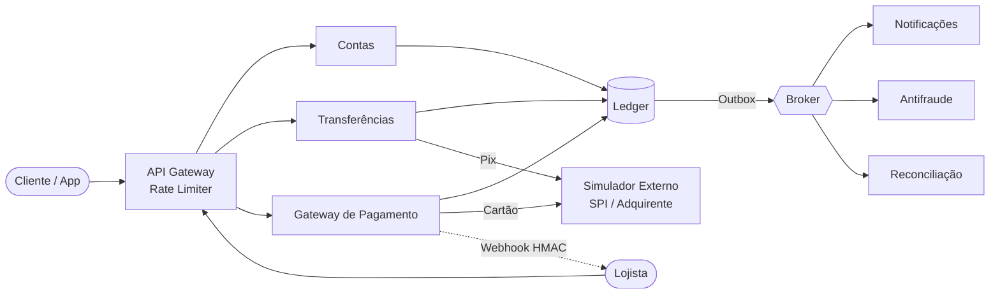
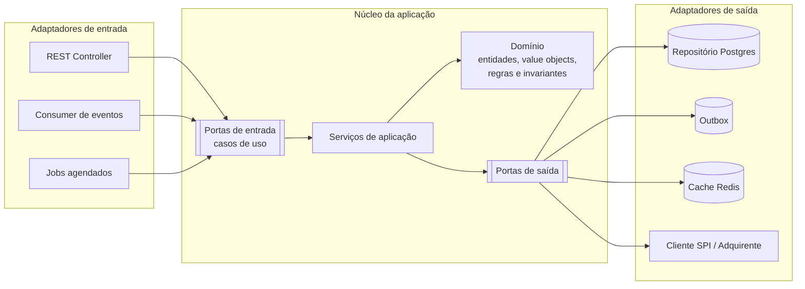

# HEX BANK

Um banco simples com gateway de pagamento, feito para **estudar na prática** os padrões de sistemas distribuídos que aparecem em produção e em entrevistas de engenharia sênior: idempotência, outbox, saga, concorrência, cache, mensageria e system design.

> **Objetivo:** não é ter muitas funcionalidades, e sim ter **corretude sob falha**. Toda decisão relevante fica registrada em `docs/adr/` e todo experimento de falha em `docs/experimentos/`.

---

## Arquitetura

### Visão geral do sistema



### Arquitetura interna dos serviços: Hexagonal (Ports & Adapters)

Cada serviço segue a arquitetura hexagonal. O **domínio** fica no centro, sem nenhuma dependência de framework, banco ou broker. Toda comunicação com o mundo externo passa por **portas** (interfaces) implementadas por **adaptadores**.



**Regra de dependência:** as dependências apontam sempre para dentro.

```
adapters  ->  application  ->  domain
```

- `domain` não importa nada de `application` nem de `adapters`, e nenhuma biblioteca de infraestrutura.
- `application` conhece apenas o `domain` e as próprias portas.
- `adapters` implementam as portas e são os únicos que conhecem framework, banco, broker e HTTP.
- Essa regra é verificada por teste de arquitetura (ex.: ArchUnit, ou equivalente na stack escolhida).

### Por que hexagonal neste projeto

| Benefício | Onde aparece |
|---|---|
| Regras de dinheiro testáveis sem banco | Invariantes do ledger testados em teste unitário puro |
| Trocar infraestrutura sem tocar no domínio | Trocar RabbitMQ por Kafka só muda o adaptador do publisher |
| Simulador plugável | `SpiPort` tem um adaptador real (mock HTTP) e um fake em memória para testes |
| Padrões ficam explícitos | Outbox é uma porta de saída; idempotência é uma responsabilidade da camada de aplicação |

### Exemplo de portas: serviço de Transferências

| Tipo | Porta | Adaptador |
|---|---|---|
| Entrada | `RealizarTransferenciaUseCase` | `TransferenciaRestController` |
| Entrada | `ConfirmarPixUseCase` | `RetornoSpiConsumer` |
| Entrada | `ResolverPendentesUseCase` | `ConsultaPendentesJob` |
| Saída | `TransferenciaRepository` | `TransferenciaPostgresAdapter` |
| Saída | `IdempotenciaRepository` | `IdempotenciaPostgresAdapter` |
| Saída | `EventoPublisher` | `OutboxPostgresAdapter` |
| Saída | `SpiPort` | `SpiHttpAdapter` (com circuit breaker e retry) |
| Saída | `LedgerPort` | `LedgerHttpAdapter` |

> Circuit breaker, retry e timeout ficam **no adaptador de saída**, não no domínio. O domínio só conhece o resultado: `SUCESSO`, `RECUSADO` ou `DESCONHECIDO`.

### Serviços

| Serviço | Responsabilidade |
|---|---|
| **contas** | Abertura de conta, consulta de saldo e extrato |
| **ledger** | Livro-razão de partidas dobradas. Imutável. Fonte da verdade do dinheiro |
| **transferencias** | Transferência interna e Pix para outros bancos (via simulador) |
| **pagamentos** | Gateway de cartão: autorização, captura, estorno e webhooks para lojistas |
| **simulador** | Mock do SPI/BACEN e da adquirente. **Falha de propósito** (timeout, latência, duplicidade) |
| **notificacoes / antifraude / reconciliacao** | Consumidores de eventos |

### Stack

| Camada | Tecnologia |
|---|---|
| Linguagem / framework | `<definir>` |
| Banco de dados | PostgreSQL |
| Cache / rate limit | Redis |
| Broker | `<RabbitMQ ou Kafka>` |
| Observabilidade | OpenTelemetry + Jaeger + Prometheus + Grafana |
| Teste de carga | k6 |
| Teste de arquitetura | `<ArchUnit ou equivalente>` |
| Infra local | Docker Compose |

---

## Regras do domínio (invioláveis)

1. **Dinheiro nunca é `double`.** Use centavos em inteiro (`long`) ou `BigDecimal`, encapsulados num value object `Dinheiro`.
2. **O ledger é imutável.** Nada é apagado nem editado. Um estorno é um novo lançamento ao contrário.
3. **Partidas dobradas.** Todo movimento gera um débito e um crédito; a soma de todos os lançamentos é sempre **zero**.
4. **Saldo é derivado.** Ele vem do ledger (ou de uma projeção dele), nunca de um campo alterado livremente.
5. **Toda operação que move dinheiro é idempotente** (`Idempotency-Key` / `endToEndId`).
6. **Timeout não é falha.** Um resultado desconhecido vira status `PENDENTE` e é resolvido por consulta, nunca por reenvio cego.
7. **Auditoria em tudo:** quem, quando, origem e chave de idempotência.
8. **O número do cartão nunca é armazenado.** Só o token.

Essas regras vivem na camada `domain` e são cobertas por testes unitários sem nenhuma infraestrutura.

### Invariante principal

```
SUM(saldos de todas as contas) == SUM(saldos iniciais) + aportes externos - saídas externas
```

Esse invariante é verificado automaticamente após cada teste de caos.

---

## Estrutura do repositório

```
mini-bank/
├── services/
│   ├── contas/
│   ├── ledger/
│   ├── transferencias/
│   ├── pagamentos/
│   ├── simulador/
│   └── consumidores/            # notificações, antifraude, reconciliação
├── infra/
│   ├── docker-compose.yml
│   └── observabilidade/
├── tests/
│   ├── carga/                   # scripts k6
│   └── caos/                    # cenários de falha
├── docs/
│   ├── adr/                     # Architecture Decision Records
│   ├── experimentos/            # resultados de testes de falha e carga
│   └── system-design/           # desenhos da semana 3
└── README.md
```

### Estrutura interna de cada serviço

Exemplo com `transferencias`:

```
services/transferencias/
├── domain/
│   ├── model/                   # Transferencia, Conta, Dinheiro, StatusTransferencia
│   ├── service/                 # regras de domínio que não pertencem a uma entidade
│   ├── event/                   # TransferenciaRealizada, PixEnviado, PixRecusado
│   └── exception/               # SaldoInsuficiente, LimiteExcedido
├── application/
│   ├── port/
│   │   ├── in/                  # RealizarTransferenciaUseCase, ConfirmarPixUseCase
│   │   └── out/                 # TransferenciaRepository, SpiPort, EventoPublisher
│   ├── service/                 # implementação dos casos de uso, orquestração da saga
│   └── dto/                     # comandos e resultados dos casos de uso
├── adapters/
│   ├── in/
│   │   ├── web/                 # controllers REST, validação de entrada, Idempotency-Key
│   │   ├── messaging/           # consumers
│   │   └── scheduler/           # jobs
│   └── out/
│       ├── persistence/         # repositórios Postgres, entidades de banco, mappers
│       ├── outbox/              # gravação na tabela outbox
│       ├── spi/                 # cliente HTTP + circuit breaker + retry
│       └── cache/               # Redis
├── config/                      # injeção de dependência, wiring das portas
└── tests/
    ├── unit/                    # domain e application, com fakes das portas
    ├── integration/             # adaptadores com Testcontainers
    └── architecture/            # verificação da regra de dependência
```

### Estratégia de testes por camada

| Camada | Tipo de teste | Infraestrutura |
|---|---|---|
| `domain` | Unitário | Nenhuma |
| `application` | Unitário com fakes das portas de saída | Nenhuma |
| `adapters` | Integração | Testcontainers (Postgres, Redis, broker) |
| Sistema | Carga e caos | Docker Compose completo |
| Arquitetura | Regra de dependência | Nenhuma |

---

## Como rodar

```bash
# subir infraestrutura e serviços
docker compose -f infra/docker-compose.yml up -d

# rodar testes
<comando de teste>

# teste de carga
k6 run tests/carga/transferencias.js

# verificar invariante do ledger
<comando/script de verificação>
```

### Configurando falhas no simulador

```env
SIM_TAXA_FALHA=0.15        # 15% das chamadas falham
SIM_TAXA_TIMEOUT=0.05      # 5% dão timeout (mas a operação FOI executada)
SIM_LATENCIA_MS=50-2000    # latência aleatória
SIM_DUPLICAR_RESPOSTA=0.02 # 2% das respostas chegam em dobro
```

---

## Roadmap

### Semana 1 - Transferência confiável
*Idempotência, Outbox, Saga, Retry, Circuit Breaker*

- [ ] **Dia 1** - Setup do docker-compose, estrutura hexagonal dos serviços, abertura de conta e ledger de partidas dobradas
    - Pronto quando: a soma de todos os lançamentos é zero e o teste de arquitetura passa
- [ ] **Dia 2** - `POST /transferencias` com `Idempotency-Key`
    - Pronto quando: 10 requisições iguais geram 1 transferência
- [ ] **Dia 3** - Transactional Outbox para o evento `TransferenciaRealizada`
    - Pronto quando: com o broker derrubado, nenhum evento se perde ao voltar
- [ ] **Dias 4-5** - Saga do Pix: bloquear saldo, enviar ao SPI, confirmar ou compensar
    - Pronto quando: uma recusa do SPI desbloqueia o saldo corretamente
- [ ] **Dia 6** - Timeout com resultado desconhecido: estado `PENDENTE` + consulta de status + retry com backoff e jitter + DLQ
    - Pronto quando: nenhum Pix é enviado em dobro com o simulador dando timeout
- [ ] **Dia 7** - Circuit breaker no `SpiHttpAdapter`
    - Pronto quando: com o SPI fora do ar, a API responde rápido com "em processamento"

**Teste de caos da semana:** 1.000 transferências aleatórias com o simulador a 20% de falha e serviços sendo derrubados. **O invariante precisa se manter.**

---

### Semana 2 - Saldo sob pressão
*Concorrência, Isolamento, Cache, Mensageria*

- [ ] **Dia 1** - Reproduzir o gasto duplo: 50 saques simultâneos numa conta com R$ 100
    - Pronto quando: o bug é reproduzido de forma consistente
- [ ] **Dia 2** - Corrigir de 3 formas e comparar: `SELECT FOR UPDATE`, optimistic locking e `UPDATE ... WHERE saldo >= valor`
    - Pronto quando: há uma tabela de throughput, latência p99 e taxa de conflito para cada uma
    - Dica hexagonal: as três estratégias são adaptadores diferentes da mesma porta de saída
- [ ] **Dia 3** - Deadlock em transferências A->B e B->A simultâneas
    - Pronto quando: as contas são travadas sempre na mesma ordem e não há mais deadlock
- [ ] **Dia 4** - Write skew no limite diário de Pix
    - Pronto quando: o problema é demonstrado em READ COMMITTED e resolvido
- [ ] **Dia 5** - Cache de extrato no Redis (cache-aside + invalidação + proteção contra stampede)
    - Pronto quando: há um ADR explicando por que o saldo usado no débito **não** vem do cache
- [ ] **Dia 6** - Consumidores idempotentes (inbox) + ordenação por `conta_id`
    - Pronto quando: mensagens duplicadas ou fora de ordem não corrompem o estado
- [ ] **Dia 7** - Job de reconciliação: ledger x extrato do simulador
    - Pronto quando: as divergências são detectadas e reportadas

---

### Semana 3 - System Design
*Rate Limiter, Gateway de Pagamento, Extrato, Encurtador, Pix em escala*

- [ ] **Dias 1-2** - Rate limiter (token bucket no Redis com script Lua) por conta e por IP - **implementar**
    - Pronto quando: o teste com k6 mostra o limite sendo respeitado sob carga
- [ ] **Dia 3** - Gateway de pagamento: autorizar, capturar, estornar + webhook com HMAC - **implementar**
    - Pronto quando: o lojista recebe webhooks assinados com retry; o cartão é tokenizado
- [ ] **Dia 4** - Extrato como feed: paginação por cursor, dados quentes e frios - **no papel**
- [ ] **Dia 5** - Encurtador de URL (links de cobrança) - **no papel**
- [ ] **Dia 6** - "Desenhe o Pix de um banco com 50 milhões de clientes" - **no papel**
- [ ] **Dia 7** - Simulação de entrevista: 45 min, cronometrado, explicando em voz alta

**Roteiro para cada design:** requisitos, estimativas de volume, API, modelo de dados, arquitetura geral, gargalos e falhas, trade-offs.

---

## Resultados e métricas

> Preencha conforme os experimentos. Esta seção é material para entrevistas.

| Experimento | Configuração | Resultado |
|---|---|---|
| Lock pessimista | `<req/s>` | p99: `<ms>` / conflitos: `<%>` |
| Optimistic locking | `<req/s>` | p99: `<ms>` / conflitos: `<%>` |
| UPDATE condicional | `<req/s>` | p99: `<ms>` / conflitos: `<%>` |
| Caos semana 1 | 1.000 transferências, 20% falha | invariante: `<ok/falhou>` |

---

## Decisões de arquitetura (ADRs)

Template em `docs/adr/0000-template.md`:

```markdown
# ADR-XXXX: <título>
- **Status:** proposto | aceito | substituído
- **Contexto:** qual problema e quais restrições
- **Decisão:** o que foi escolhido
- **Alternativas consideradas:** e por que foram descartadas
- **Consequências:** o que ganhamos e o que pagamos
```

ADRs planejados:

- [ ] ADR-0001 - Arquitetura hexagonal nos serviços
- [ ] ADR-0002 - Ledger de partidas dobradas e saldo derivado
- [ ] ADR-0003 - Saga orquestrada vs. coreografada
- [ ] ADR-0004 - Outbox com polling vs. CDC
- [ ] ADR-0005 - Estratégia de locking para débito
- [ ] ADR-0006 - O que pode e o que não pode ser cacheado

---

## Uso de IA neste projeto

| Pode gerar com IA | Escrever na mão (IA só revisa) |
|---|---|
| docker-compose, boilerplate, configuração | Domínio: ledger, value objects e invariantes |
| Adaptadores REST e mappers de persistência | Casos de uso de idempotência e outbox |
| DTOs e wiring de dependências | Saga e compensações |
| Scripts de carga básicos | Estratégias de locking |
| | Rate limiter |

**Regra:** se eu não consigo explicar uma linha, ela não entra.

---

## Referências

- *Designing Data-Intensive Applications* - Martin Kleppmann
- *Microservices Patterns* - Chris Richardson - [microservices.io](https://microservices.io)
- *Release It!* - Michael Nygard
- *Hexagonal Architecture* - Alistair Cockburn - [alistair.cockburn.us/hexagonal-architecture](https://alistair.cockburn.us/hexagonal-architecture/)
- *Get Your Hands Dirty on Clean Architecture* - Tom Hombergs