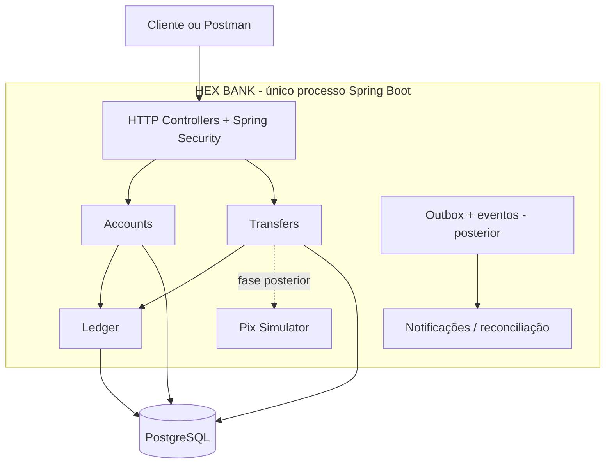

# HEX BANK

> Laboratório educacional de engenharia financeira em **Java + Spring Boot**, iniciado como **monólito modular** com arquitetura hexagonal. Não é um banco real, não movimenta dinheiro real e não oferece integração direta autorizada ao SPI.

## Missão
Construir um sistema pequeno com **corretude sob falhas**, priorizando integridade contábil, idempotência, concorrência e evidências automatizadas. Estudar padrões distribuídos gradualmente, **sem começar por microsserviços**.

## Princípios inegociáveis
1. Uma aplicação implantável inicialmente; módulos isolados por contratos explícitos.
2. Domínio Java independente de HTTP, Spring, JPA, Redis e broker.
3. Dinheiro por `Money` com moeda e unidades menores inteiras (`long` com operações exatas), sem `double`.
4. Lançamentos do ledger imutáveis; correções por lançamentos compensatórios, jamais UPDATE/DELETE.
5. Todo journal contábil fecha em débito = crédito **por moeda**.
6. Uma transferência interna deve ser atômica; nunca debitar sem creditar.
7. Idempotência persiste no PostgreSQL e funciona sob concorrência; a mesma chave + mesmo payload retorna o mesmo resultado; chave + payload diferente = conflito.
8. Nunca interpretar timeout externo como rejeição; resultado desconhecido exige consulta/reconciliação.
9. Saldo disponível não é apenas saldo contábil: considerar reservas e bloqueios.
10. Autorização e identificação de titularidade em toda operação; não confiar em `accountId` fornecido isoladamente.
11. Eventos, webhooks e consumidores toleram entregas repetidas.
12. Todo invariante e cenário crítico de falha deve ter teste reproduzível.

## Recorte inicial (MVP de estudos)
**Dentro:** contas simuladas, contas contábeis internas, funding fictício controlado, Ledger de partidas dobradas, consulta de saldos, transferências internas, idempotência, concorrência e auditoria.

**Depois:** transactional outbox, broker, consumidores, Pix simulado e Saga, pagamentos com cartão tokenizado, webhook HMAC, reconciliação externa, antifraude, Redis, rate limiting distribuído, carga e caos.

**Fora do escopo:** contas bancárias reais, Pix em produção, dados reais de cartão, liquidação regulada, KYC real e deploy de microsserviços como ponto de partida.

## Visão geral

A camada HTTP **não é um API Gateway independente**. No futuro um Gateway poderá ser colocado à frente sem reescrever regras de domínio.

## Documentação
| Documento | Conteúdo |
|---|---|
| [Arquitetura](docs/architecture/ARCHITECTURE.md) | limites de módulos, dependências e evolução |
| [Domínio e invariantes](docs/domain/BUSINESS_RULES.md) | regras verificáveis, saldos, ledger, estados |
| [Contratos HTTP](docs/contracts/HTTP_API.md) | endpoints, DTOs, semântica, erros, idempotência |
| [Contratos internos e eventos](docs/contracts/INTERNAL_EVENTS.md) | portas Java, transações e mensagens futuras |
| [Modelo de dados](docs/architecture/DATA_MODEL.md) | tabelas, índices e restrições |
| [Segurança](docs/operations/SECURITY.md) | ameaça, autorização e decisões para estudos |
| [Qualidade e falhas](docs/operations/TESTING.md) | testes, cenários e aceitação |
| [Roadmap](docs/implementation/ROADMAP.md) | sequência de implementação e critérios de pronto |
| [ADR-0001](docs/adr/0001-modular-monolith.md) | decisão de monólito modular |

## Stack inicial proposta
Java 21 LTS; Spring Boot; Gradle; PostgreSQL; Flyway; JUnit 5; Testcontainers; ArchUnit; Docker Compose. Spring Modulith é **opcional** e depende de avaliar compatibilidade e benefício no setup. Versões exatas serão fixadas ao iniciar o projeto.

## Execução
Ainda **não há código de aplicação** neste pacote. Os comandos de execução serão adicionados assim que a Fase 0 produzir um projeto executável. Não afirmar que endpoints/testes funcionam antes de implementá-los.

## Convenções de documentação
- Mudanças de contratos precisam alterar os documentos e testes correspondentes.
- Decisões irreversíveis ou que envolvem trade-offs ganham um ADR.
- Experimentos entram em `docs/experiments/`, contendo cenário, passos, resultados e evidência.
- Cada fase só termina quando seus critérios de aceitação estiverem automatizados.

## Ordem de leitura
1. Este README; 2. regras de negócio; 3. arquitetura; 4. contratos; 5. modelo de dados; 6. roadmap; 7. testes.
