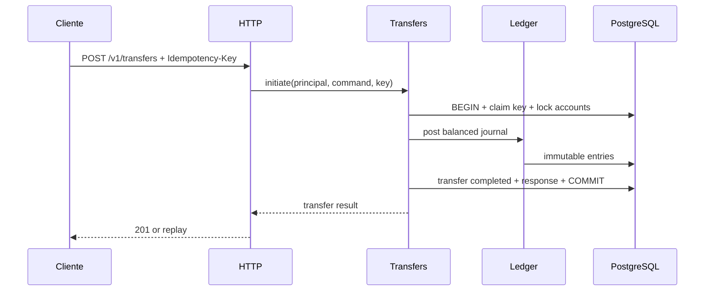

# Arquitetura — monólito modular hexagonal

## Decisão
Um **deploy Spring Boot** e **um PostgreSQL**, com schemas ou ownership de tabelas por módulo. Sem HTTP interno entre módulos. Infraestrutura do monólito não é sinônimo de ausência de fronteiras.

## Módulos e responsabilidades
| Módulo | Responsabilidade | Quando |
|---|---|---|
| `identity` | principal autenticado e autorização (mock controlado inicial; real antes de expor API) | fase 0/1 |
| `accounts` | ciclo de vida e ownership de conta, consulta de extrato via contrato do ledger | fase 1 |
| `ledger` | journals imutáveis, saldo contábil, invariantes, reserva/projeções | fase 1 |
| `transfers` | orquestração de transferências internas e idempotência | fase 2 |
| `funding` | crédito fictício de testes por contrapartida contábil; só perfil dev/test | fase 1 |
| `outbox` | persistência e publicação confiável de eventos | fase 3 |
| `pix-simulator` | dispositivo externo simulado, via adaptador, falhas controladas | fase 4 |
| `payments` | autorização/captura/estorno simulado de cartão tokenizado | fase 5 |
| `notifications`, `fraud`, `reconciliation` | projeções, sinais e confrontação de dados | fases 3–6 |

## Camadas por módulo
```text
com.hexbank
  accounts/
    domain/                   # entidades, objetos de valor, regras puras
    application/
      port/in/                # casos de uso
      port/out/               # interfaces para persistência/outros módulos
      service/                # orquestração
    adapter/in/http/          # REST e validações de transporte
    adapter/out/persistence/  # JPA/JDBC/Postgres
    config/                   # composition root local
  ledger/...
  transfers/...
  shared/                     # APENAS tipos técnicos realmente comuns
  bootstrap/                  # aplicação e wiring
```

**Regra de dependência:** `adapter -> application -> domain`. Domínio não conhece framework. Cada módulo publica pequena API Java explícita (`port/in` ou facade pública). **Não** importar JPA entities, repositórios ou tabelas privadas de outro módulo. Proibir ciclos com ArchUnit; Spring Modulith pode complementar.

## Fronteiras transacionais
- Transferência interna: uma transação ACID PostgreSQL cobre verificação/autorização, reserva ou débito, journal balanceado, transferência, idempotência e eventual outbox quando usada.
- Aplicação não chama API HTTP externa dentro de transação longa.
- Eventos assíncronos posteriores à persistência exigem **Outbox na mesma transação**; publicação via polling e retentativas, consumo idempotente.
- Evitar `REQUIRES_NEW` acidental separando lançamentos da operação; padronizar transações nas application services.

## Fluxos


## Evolução
1. Camada HTTP incorporada ao monólito.
2. Se necessário, adicionar reverse proxy/API Gateway externo para roteamento, autenticação de borda e rate limit. **Controles de autorização continuam em cada backend**.
3. Extrair serviço só com necessidade comprovada (deploy, escala, ownership). Antes: contrato estável, sem acesso cruzado a tabelas, eventos versionados, observabilidade e testes de contrato.
4. Ao extrair ledger/transfers, a atomicidade local deixa de existir: redesenhar fluxo transacional, não simplesmente trocar interface Java por HTTP.

## Não objetivos iniciais
Kubernetes, service discovery, service mesh, saga interna desnecessária, Kafka só por moda, Redis como fonte de saldo.
