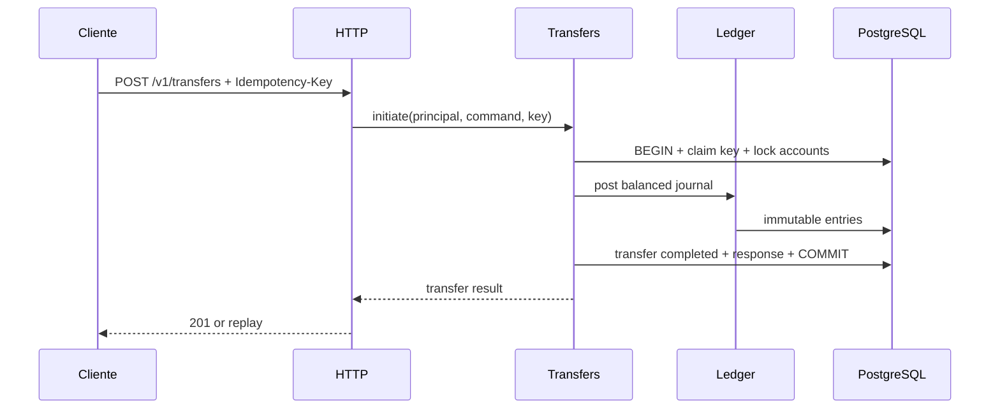

# Arquitetura — monólito modular hexagonal

## Decisão
Um **deploy Spring Boot** e **um PostgreSQL**, com schemas ou ownership de tabelas por módulo. Sem HTTP interno entre módulos. Infraestrutura do monólito não é sinônimo de ausência de fronteiras.

## Módulos e responsabilidades
| Módulo | Responsabilidade | Quando |
|---|---|---|
| `identity` | principal autenticado e autorização (mock controlado inicial; real antes de expor API) | fase 0/1 |
| `accounts` | ciclo de vida e ownership de conta, consulta de extrato via contrato do ledger | fase 1 |
| `ledger` | journals imutáveis, saldo contábil, invariantes, reserva/projeções | fase 1 |
| `transfers` | orquestração de transferências internas e idempotência | fase 2 |
| `funding` | crédito fictício de testes por contrapartida contábil; só perfil dev/test | fase 1 |
| `outbox` | persistência e publicação confiável de eventos | fase 3 |
| `pix-simulator` | dispositivo externo simulado, via adaptador, falhas controladas | fase 4 |
| `payments` | autorização/captura/estorno simulado de cartão tokenizado | fase 5 |
| `notifications`, `fraud`, `reconciliation` | projeções, sinais e confrontação de dados | fases 3–6 |

## Camadas por módulo
```text
com.hexbank
  accounts/
    domain/                   # entidades, objetos de valor, regras puras
    application/
      port/in/                # casos de uso
      port/out/               # interfaces para persistência/outros módulos
      service/                # orquestração
    adapter/in/http/          # REST e validações de transporte
    adapter/out/persistence/  # JPA/JDBC/Postgres
    config/                   # composition root local
  ledger/...
  transfers/...
  shared/
    domain/                   # shared kernel mínimo: Money, InstanceCurrency
    adapter/in/http/          # tipos técnicos comuns (erro problem+json, request id)
  bootstrap/                  # aplicação e wiring
```

**Regra de dependência:** `adapter -> application -> domain`. Domínio não conhece framework. Cada módulo publica pequena API Java explícita (`port/in` ou facade pública). **Não** importar JPA entities, repositórios ou tabelas privadas de outro módulo. Proibir ciclos com ArchUnit; Spring Modulith pode complementar.

## Como ler as especificações de implementação
Todo tipo de domínio e todo caso de uso segue o mesmo formato. Para novos itens, copiar o [modelo de especificação](../implementation/SPEC_TEMPLATE.md).

1. **Status e regras:** se já está implementado (com o teste que prova) e quais BRs/ADRs ele cumpre, com link.
2. **Campos:** nome, tipo Java e regra de cada campo.
3. **Contrato:** assinaturas públicas, retorno e exceções. Quando chega na API, também o HTTP (status, corpo e `code`).
4. **Histórias:** no formato "Como … quero … para …", com critérios de aceite **Dado / Quando / Então** e o **resultado esperado em números**. Cada critério vira pelo menos um teste.
5. **Fora do escopo** e **Pronto quando**.

**Dois tipos de erro, sempre separados:**

| Situação | Exceção | HTTP |
|---|---|---|
| Recusa de negócio: o cliente pode corrigir ou é uma regra do produto | subclasse de `BusinessException` com `code` estável | `4xx` com `code` (ver [códigos da Fase 1](#códigos-de-erro-novos-na-fase-1)) |
| Erro de programação: o chamador montou algo inválido | `IllegalArgumentException`, `IllegalStateException`, `NullPointerException`, `ArithmeticException` | `500 INTERNAL_ERROR`, nunca `4xx` |

## Shared kernel (`shared/domain`)
Tipos de domínio usados por vários módulos e sem dono natural. Hoje: **`Money`, `InstanceCurrency`** (enum com as moedas suportadas; só `BRL` no MVP) **e `IdempotencyKey`**. Na Fase 1 entra também `AuditEntry` com sua porta de saída (ver "Tipos comuns da Fase 1 em `shared`").

- **Por que não no `ledger`:** `accounts`, `transfers` e `funding` também usam `Money`. Com o tipo no ledger, todo módulo dependeria do ledger só por um objeto de valor, e o ledger nunca poderia depender de nenhum deles sem criar ciclo.
- **Entra:** objetos de valor imutáveis, estáveis e sem regra específica de um módulo.
- **Não entra:** IDs de módulos (`AccountId`, `JournalId`, `TransferId`), regras de saldo (BR-016 é do ledger), entidades, portas ou qualquer dependência de framework.
- **Regra de dependência:** `shared` não depende de nenhum módulo (`accounts`, `ledger`, ...). Verificado por `ArchitectureTest.sharedDoesNotDependOnModules`, junto da regra que mantém `..domain..` livre de framework.

### `Money` — o que deve fazer e respeitar
Regras de negócio: **[BR-001](../domain/BUSINESS_RULES.md#dinheiro-e-contas)** (moeda conhecida, sem overflow silencioso, sem `double`) e **[BR-052](../domain/BUSINESS_RULES.md#auditoria-e-estados)** (sempre unidade menor + moeda explícita). Uso no ledger: [ADR-0002](../adr/0002-convencao-contabil.md).

| Regra | Comportamento esperado |
|---|---|
| Representação | `InstanceCurrency` + `long minorUnits` (R$ 100,00 = `BRL` / `10000`). Nunca `double`/`float`; `BigDecimal` só na borda, se necessário |
| Moeda | apenas moedas de `InstanceCurrency` (`BRL` no MVP), garantido pelo tipo; moeda nula é rejeitada na criação |
| Imutável | operações devolvem novo `Money`; igualdade por valor (moeda + `minorUnits`) |
| Mesma moeda | somar, subtrair ou comparar moedas diferentes lança erro, nunca converte |
| Overflow | `Math.addExact`/`subtractExact`: overflow é exceção, nunca valor errado |
| Sinal | `Money` pode ser zero ou negativo como resultado de cálculo; **quem exige positivo é o chamador** (ex.: `JournalEntry` exige `> 0`, ADR-0002; transferência exige `amount > 0`, BR-020) |
| Sem arredondamento | não há divisão nem porcentagem no MVP; quando houver (taxas), entra por ADR com regra de arredondamento explícita |
| Serialização | API usa `{"currency":"BRL","minorUnits":10000}` ([HTTP_API.md](../contracts/HTTP_API.md)); a conversão para decimal é da UI |
| Domínio puro | sem Spring, JPA ou Jackson dentro do tipo; mapeamento fica nos adapters |

## Domínio do módulo `accounts`

### `Account` — o que deve fazer e respeitar
**Status:** ✅ implementado (`accounts/domain/Account.java`; testes em `AccountTest`). Além do `open`, existe `restore(...)` para o adapter recriar a conta a partir do banco (valida `closedAt` preenchido se e somente se `CLOSED`).

Regras de negócio: **[BR-002](../domain/BUSINESS_RULES.md#dinheiro-e-contas)** (id imutável, dono, moeda, status; só `ACTIVE` movimenta), **[BR-004](../domain/BUSINESS_RULES.md#dinheiro-e-contas)** (dono vem do principal, não do payload) e **[BR-005](../domain/BUSINESS_RULES.md#dinheiro-e-contas)** (conta fechada não opera). Ciclo de vida: [ADR-0003](../adr/0003-ciclo-de-vida-e-encerramento-de-contas.md). Relação com o ledger: [ADR-0002](../adr/0002-convencao-contabil.md).

**O `Account` não guarda saldo.** Saldo é do ledger (BR-013); o `Account` cuida de identidade, dono, moeda e ciclo de vida.

**Estado**

| Campo | Tipo | Regra |
|---|---|---|
| `id` | `AccountId` (UUID) | imutável |
| `ownerId` | `PrincipalId` (`identity/domain`) | imutável; vem do principal autenticado |
| `currency` | `InstanceCurrency` | imutável; a `LedgerAccount` da conta usa a mesma moeda |
| `status` | `ACTIVE` \| `BLOCKED` \| `CLOSED` | muda só por transição permitida |
| `createdAt` | `Instant` UTC | definido na criação |
| `closedAt` | `Instant` opcional | preenchido **se e somente se** `status = CLOSED` |

**Comportamento**

| Regra | Comportamento esperado |
|---|---|
| Criação | fábrica (ex.: `Account.open(id, ownerId, currency, now)`) cria sempre `ACTIVE`, `closedAt` nulo; nenhum campo obrigatório nulo |
| Dono | `isOwnedBy(PrincipalId)` para a BR-004; negar acesso é decisão do caso de uso |
| Exigir ativa | `requireActive()` lança `AccountNotActiveException` (`409 ACCOUNT_NOT_ACTIVE`) se não `ACTIVE`; usado por funding e transferência (origem **e** destino) |
| Bloquear / desbloquear | `block()`: `ACTIVE → BLOCKED`; `unblock()`: `BLOCKED → ACTIVE` |
| Encerrar | `close(now)`: `ACTIVE`/`BLOCKED → CLOSED`, preenche `closedAt` |
| Idempotência | transição para o status atual não faz nada e não falha |
| `CLOSED` terminal | qualquer transição a partir de `CLOSED` lança `InvalidStatusTransitionException` (`409 INVALID_STATUS_TRANSITION`) |
| Exceções | `AccountNotActiveException` e `InvalidStatusTransitionException` estendem `BusinessException`, em `accounts/domain` |
| Domínio puro | sem Spring, JPA ou Jackson; mapeamento fica nos adapters |

**Não é responsabilidade do `Account`**

- **Saldo e conciliação:** encerrar exige saldo zero e nenhum hold ativo (ADR-0003), mas quem verifica é o **caso de uso**, consultando o ledger pela porta pública na mesma transação. `Account.close()` só valida a transição.
- **Autorização por papel:** "só admin bloqueia" e "titular não encerra conta `BLOCKED`" ficam no caso de uso, porque dependem de papéis do `identity`.
- **Criar a `LedgerAccount`:** o caso de uso de abertura cria `Account` e `LedgerAccount` `LIABILITY` na mesma transação (ADR-0002, `UNIQUE(account_id)`).

**Escopo na Fase 1:** mínimo `open`, `isOwnedBy` e `requireActive`. `block`, `unblock` e `close` podem esperar os endpoints, mas as regras do ADR-0003 já valem no domínio e são baratas de implementar e testar agora.

### `AccountId`
`record` com `UUID` não nulo, em `accounts/domain`. Só o módulo `accounts` usa este tipo; para os outros módulos o id da conta é um `UUID` puro (ver "Dependências entre módulos na Fase 1").

### Casos de uso de `accounts`
**Status:** ⏳ a implementar. Regras: **[BR-001](../domain/BUSINESS_RULES.md#dinheiro-e-contas)**, **[BR-002](../domain/BUSINESS_RULES.md#dinheiro-e-contas)**, **[BR-004](../domain/BUSINESS_RULES.md#dinheiro-e-contas)**, **[BR-050](../domain/BUSINESS_RULES.md#auditoria-e-estados)**, **[BR-052](../domain/BUSINESS_RULES.md#auditoria-e-estados)**. Contrato HTTP: [criar conta](../contracts/HTTP_API.md#criar-conta-fase-1) e [consultar conta e saldo](../contracts/HTTP_API.md#consultar-conta-e-saldo-fase-1). Depende de: [API pública do ledger](#api-pública-do-ledger-applicationportin) e [AuditEntry](#auditentry-e-porta-de-auditoria).

**Contrato (`accounts/application/port/in`)**

```java
public interface OpenAccountUseCase {
    Account open(OpenAccountCommand command);
}
public record OpenAccountCommand(PrincipalId ownerId, InstanceCurrency currency, String requestId) {}

public interface GetAccountQuery {
    Account get(PrincipalId principal, AccountId id);          // AccountNotFoundException
    AccountBalanceView balance(PrincipalId principal, AccountId id); // AccountNotFoundException
}
public record AccountBalanceView(UUID accountId, Money booked, Money reserved, Money available, Instant asOf) {}
```

| Exceção | Onde fica | HTTP |
|---|---|---|
| `AccountNotFoundException` (estende `BusinessException`) | `accounts/domain/exceptions` | `404 ACCOUNT_NOT_FOUND` |
| `CurrencyNotSupportedException` (já existe) | `shared/domain/exceptions` | `400 INVALID_REQUEST` |

O id (`UUID.randomUUID()`) e o instante (`Clock` injetado) são gerados pelo serviço, nunca recebidos do cliente. Com o `Clock` injetado, os testes ficam determinísticos.

#### ACC-UC-01 — Abrir conta (`POST /v1/accounts`)
> **Como** cliente autenticado, **quero** abrir uma conta em BRL, **para** poder receber dinheiro.

| # | Dado | Quando | Então |
|---|---|---|---|
| 1 | principal `P` autenticado | `POST /v1/accounts` com `{"currency":"BRL"}` | `201` com `{"id":"<uuid>","currency":"BRL","status":"ACTIVE"}`; `Account.ownerId = P` |
| 2 | o mesmo pedido acima | a transação termina | existem, **na mesma transação**: 1 `Account` `ACTIVE`, 1 `LedgerAccount` `LIABILITY` BRL com `accountId` = id da conta, 1 projeção zerada e 1 auditoria `ACCOUNT_CREATED` (`aggregateType = ACCOUNT`, `aggregateId` = id da conta) |
| 3 | o corpo traz `"ownerId":"<outro>"` | `POST /v1/accounts` | o campo é ignorado; o dono continua `P` (BR-004) |
| 4 | moeda `"USD"` ou ausente | `POST /v1/accounts` | `400 INVALID_REQUEST`; nada é gravado |
| 5 | `P` já tem uma conta | abre outra | `201` com um id novo (várias contas por dono são permitidas) |
| 6 | o ledger falha ao criar a conta contábil | `POST /v1/accounts` | rollback: nem `Account`, nem `LedgerAccount`, nem auditoria |
| 7 | sem principal | `POST /v1/accounts` | `401 UNAUTHENTICATED` |

#### ACC-UC-02 — Consultar conta (`GET /v1/accounts/{id}`)
> **Como** dono da conta, **quero** ver os dados dela, **para** saber a moeda e se ela está ativa.

| # | Dado | Quando | Então |
|---|---|---|---|
| 1 | conta `A` de `P` | `P` faz `GET /v1/accounts/A` | `200` com `id`, `currency`, `status` |
| 2 | conta `A` de `P` | outro principal `Q` faz `GET /v1/accounts/A` | `404 ACCOUNT_NOT_FOUND` (não é `403`, para não revelar que a conta existe) |
| 3 | id inexistente | `GET` | `404 ACCOUNT_NOT_FOUND` |
| 4 | conta `BLOCKED` ou `CLOSED` | o dono faz `GET` | `200` (a consulta funciona em qualquer status, ADR-0003) |
| 5 | id que não é UUID | `GET /v1/accounts/abc` | `400 INVALID_REQUEST` |

#### ACC-UC-03 — Consultar saldo (`GET /v1/accounts/{id}/balance`)
> **Como** dono da conta, **quero** ver o saldo contábil, o reservado e o disponível, **para** saber quanto posso movimentar.

| # | Dado | Quando | Então |
|---|---|---|---|
| 1 | conta nova | o dono faz `GET .../balance` | `200` com `{"accountId":"…","currency":"BRL","bookedMinorUnits":0,"reservedMinorUnits":0,"availableMinorUnits":0,"asOf":"…"}` |
| 2 | conta com funding de R$ 100 | `GET .../balance` | `bookedMinorUnits = 10000`, `availableMinorUnits = 10000` |
| 3 | conta de outro dono ou inexistente | `GET .../balance` | `404 ACCOUNT_NOT_FOUND` |
| 4 | qualquer conta | `GET .../balance` | os valores vêm da [consulta de saldo do ledger](#led-uc-03--consultar-saldo); o `accounts` não calcula nada |

**Fora do escopo:** bloquear, desbloquear e encerrar por HTTP (o domínio já suporta, ADR-0003); extrato.
**Pronto quando:** `@WebMvcTest` cobre ACC-UC-01 a 03 (status, corpo, `code`); um teste de integração com Postgres prova ACC-UC-01 #2 e #6.

## Domínio do módulo `ledger`
Regras de negócio: **[BR-010 a BR-016](../domain/BUSINESS_RULES.md#ledger)**. Convenção contábil: **[ADR-0002](../adr/0002-convencao-contabil.md)**, que tem precedência sobre esta seção em caso de dúvida.

### `LedgerAccountType` e `EntrySide`
**Status:** ✅ implementado (testes em `LedgerAccountTypeTest`). O delta é calculado por `type.delta(side, minorUnits)`, usado pela [BalanceProjection](#balanceprojection).

| Regra | Comportamento esperado |
|---|---|
| Tipos | `ASSET`, `LIABILITY`, `EQUITY` no MVP (`INCOME`/`EXPENSE` só por ADR) |
| Lados | `EntrySide` = `DEBIT` \| `CREDIT` |
| Saldo normal | `type.normalBalance()`: `ASSET → DEBIT`; `LIABILITY` e `EQUITY → CREDIT`. Derivado, nunca informado; não é campo do `LedgerAccount`. No banco, `normal_balance` é coluna gerada a partir de `type` (ADR-0002) |
| Delta | `+valor` se o lado do entry é o saldo normal da conta, `−valor` caso contrário (ADR-0002, seção 5) |

### `LedgerAccount`
**Status:** ✅ implementado (testes em `LedgerAccountTest`).

| Campo | Tipo | Regra |
|---|---|---|
| `id` | `LedgerAccountId` (UUID) | imutável |
| `accountId` | `UUID` opcional | conta de cliente; nulo em conta institucional; único (`UNIQUE(account_id)`) |
| `code` | texto opcional | conta institucional (ex.: `SIMULATED_CASH:BRL`); nulo em conta de cliente; único |
| `currency` | `InstanceCurrency` | imutável |
| `type` | `LedgerAccountType` | **imutável** (erro de tipo inverte lançamentos, ADR-0002) |

| Regra | Comportamento esperado |
|---|---|
| Exatamente um vínculo | ou `accountId` ou `code`, nunca os dois e nunca nenhum |
| Conta de cliente | fábrica `forCustomer(id, accountId, currency)` cria sempre `LIABILITY` |
| Conta institucional | fábrica `institutional(id, code, type, currency)`; no MVP só existe `SIMULATED_CASH:BRL` (`ASSET`), criada pela `V3__ledger.sql` com UUID fixo |
| Saldo negativo | `allowsNegativeAvailable()`: `false` para cliente, `true` para institucional (BR-016) |
| Sem status | não tem status nem conhece o status da conta (ADR-0003) |

### `JournalEntry`
**Status:** ✅ implementado (`ledger/domain/JournalEntry.java`; testes em `JournalEntryTest`). Regras: **[BR-010](../domain/BUSINESS_RULES.md#ledger)**, **[BR-011](../domain/BUSINESS_RULES.md#ledger)**, [ADR-0002](../adr/0002-convencao-contabil.md) seção 1.

Uma linha do lançamento. Não tem id próprio: faz parte do `Journal`. O `id` e o `journal_id` da tabela `journal_entries` são da persistência ([DATA_MODEL](DATA_MODEL.md)), e o `Money` vira as colunas `minor_units` + `currency`.

| Campo | Tipo | Regra |
|---|---|---|
| `ledgerAccountId` | `LedgerAccountId` | não nulo |
| `side` | `EntrySide` | `DEBIT` \| `CREDIT`, não nulo |
| `amount` | `Money` | `amount.isPositive()`; zero ou negativo → `IllegalArgumentException` |

| Regra | Comportamento esperado |
|---|---|
| Moeda | moeda do `amount` = moeda da `LedgerAccount`; verificado pelo [lançamento](#led-uc-02--lançar-journal), quando a conta é carregada |
| Estorno | `reversed()` devolve um entry novo, com a mesma conta e o mesmo valor e o lado invertido |
| Imutável | `record` (acessores `ledgerAccountId()`, `side()`, `amount()`), sem setters; nunca UPDATE/DELETE (BR-011) |
| Igualdade | por valor (`equals`/`hashCode` gerados pelo `record`): dois entries com mesma conta, lado e valor são iguais |

### `Journal`
**Status:** ✅ implementado (`ledger/domain/Journal.java`; testes em `JournalTest`). Regras: **[BR-010](../domain/BUSINESS_RULES.md#ledger)**, **[BR-011](../domain/BUSINESS_RULES.md#ledger)**, **[BR-012](../domain/BUSINESS_RULES.md#ledger)**, [ADR-0002](../adr/0002-convencao-contabil.md).

| Campo | Tipo | Regra |
|---|---|---|
| `id` | `JournalId` (`record` com `UUID`) | não nulo |
| `referenceType` | `JournalReferenceType` | `FUNDING`, `TRANSFER` (Fase 2), `REVERSAL` |
| `referenceId` | `UUID` | id da operação que gerou o journal. É `UUID` puro para o ledger não depender de `funding`/`transfers` |
| `createdAt` | `Instant` | vem de fora (`now`); o domínio não lê o relógio |
| `reversalOf` | `JournalId`, pode ser nulo | getter devolve `Optional<JournalId>`; preenchido só em `REVERSAL` |
| `entries` | `List<JournalEntry>` | copiada com `List.copyOf` (imutável, sem `null`) |

**Contrato**

```java
public static Journal post(JournalId id, JournalReferenceType referenceType, UUID referenceId,
                           Instant createdAt, List<JournalEntry> entries); // REVERSAL é rejeitado
public Journal reverse(JournalId newId, Instant now);                   // gera o estorno
```

O construtor é privado: só essas duas fábricas criam journals. Assim, `REVERSAL` sempre tem `reversalOf` e `FUNDING`/`TRANSFER` nunca têm.

| Regra | Comportamento esperado |
|---|---|
| Referência | par `(referenceType, referenceId)` único (BR-012), garantido por `UNIQUE` no banco |
| Mínimo de entries | `≥ 2` (BR-010) |
| Balanceado | Σ débitos = Σ créditos, somados com `Money.plus` (overflow → `ArithmeticException`) (BR-010) |
| Uma moeda | todos os entries na mesma moeda (MVP rejeita journal multimoeda); checado **antes** do balanceamento |
| Conta repetida | a mesma `LedgerAccount` não aparece em dois entries do mesmo journal (débito e crédito na mesma conta é lançamento vazio) |
| Imutável | lista de entries copiada na criação e exposta só para leitura (BR-011) |
| Estorno | `reverse(newId, now)` gera journal novo com `reversalOf = id`, `referenceType = REVERSAL`, `referenceId = id.value()`, mesmas contas e valores, lados invertidos. `newId` igual ao `id` original é rejeitado. Estornar um estorno → `IllegalStateException`. No máximo um estorno por original (`UNIQUE(reversal_of)` no banco) |
| Validação | tudo validado no construtor/fábrica: um `Journal` inválido não existe |

Journal desbalanceado, multimoeda ou com entry inválido indica **bug do chamador**, não erro do cliente: vira `IllegalArgumentException`/`IllegalStateException`, mapeada para `500 INTERNAL_ERROR`, nunca `4xx`.

**Pendente fora do domínio:** a unicidade de `(reference_type, reference_id)` e de `reversal_of` vai na `V3__ledger.sql`, com teste de integração. O teste de "uma moeda" entra quando o `InstanceCurrency` ganhar uma segunda moeda.

### `BalanceProjection`
**Status:** ✅ implementado (`ledger/domain/BalanceProjection.java`, `ledger/domain/exceptions/InsufficientFundsException.java`; testes em `BalanceProjectionTest`, LED-BP-01 a 08). LED-BP-09 e 10 ficam para a integração, depois da `V3__ledger.sql`. Os casos de moeda diferente (LED-BP-06 #3, LED-BP-08 #4) estão `@Disabled` até existir uma segunda moeda. Regras: **[BR-013](../domain/BUSINESS_RULES.md#ledger)** (saldo só muda por lançamento), **[BR-014](../domain/BUSINESS_RULES.md#ledger)** (disponível = contábil − reservas), **[BR-016](../domain/BUSINESS_RULES.md#ledger)** (cliente nunca negativo), **[BR-022](../domain/BUSINESS_RULES.md#transferências-internas)** (concorrência), [ADR-0002](../adr/0002-convencao-contabil.md) seções 5 e 6. Tabela: `balance_projections` ([DATA_MODEL](DATA_MODEL.md)).

O saldo de uma conta contábil, mantido atualizado a cada entry para não ser preciso somar todos os entries em cada consulta. Ela é uma **cópia derivada** do ledger: a fonte de verdade continuam sendo os entries.

**Campos**

| Campo | Tipo | Regra |
|---|---|---|
| `ledgerAccountId` | `LedgerAccountId` | imutável; é a PK da tabela |
| `booked` | `Money` | saldo contábil no sentido normal da conta (positivo = "tem valor", ADR-0002 seção 5); mesma moeda da `LedgerAccount`. Só fica negativo em conta institucional |
| `reserved` | `Money` | `≥ 0`, mesma moeda de `booked`. **Sempre zero na Fase 1** (holds entram na Fase 4) |
| `version` | `long` | `≥ 0`; versão **lida do banco**. O domínio não incrementa: quem incrementa é o adapter, no `UPDATE` condicional (história LED-BP-09) |

Derivado (não é campo): `available()` = `booked.minus(reserved)`, retorna `Money`.

**Contrato**

```java
public final class BalanceProjection {
    public static BalanceProjection zeroFor(LedgerAccount account);                // conta nova
    public static BalanceProjection restore(LedgerAccountId ledgerAccountId,
                                            Money booked, Money reserved, long version); // vinda do banco
    public BalanceProjection apply(JournalEntry entry, LedgerAccount account);      // devolve uma NOVA projeção
    public Money available();
    // getters: getLedgerAccountId(), getBooked(), getReserved(), getVersion()
}

// ledger/domain/exceptions — estende BusinessException → 409 INSUFFICIENT_FUNDS
public class InsufficientFundsException extends BusinessException { }
```

- **Imutável:** `apply` devolve uma projeção nova e não altera a atual. Se `apply` lançar exceção, a projeção original continua intacta, e a regra "nada é gravado" é cumprida sem esforço.
- **Delta:** `account.getType().delta(entry.side(), entry.amount().minorUnits())` (já existe em `LedgerAccountType`), somado com `booked.plus(...)`.
- **Por que `apply` recebe a `LedgerAccount`:** a projeção precisa do `type` (para o delta) e de `allowsNegativeAvailable()` (BR-016), mas não guarda essas informações, que são da conta.

#### LED-BP-01 — Projeção zerada na abertura
> **Como** ledger, **quero** que toda conta contábil nasça com uma projeção zerada, **para** que a consulta de saldo sempre encontre uma linha, sem um estado de "saldo inexistente".

| # | Dado | Quando | Então |
|---|---|---|---|
| 1 | conta de cliente BRL com id `L1` | `zeroFor(conta)` | `ledgerAccountId = L1`, `booked = BRL 0`, `reserved = BRL 0`, `available() = BRL 0`, `version = 0` |
| 2 | `SIMULATED_CASH:BRL` | `zeroFor(conta)` | mesmo resultado, com o id do caixa simulado |
| 3 | `null` | `zeroFor(null)` | `NullPointerException` |

#### LED-BP-02 — Conta de cliente (`LIABILITY`): crédito aumenta, débito diminui
> **Como** cliente, **quero** que um crédito na minha conta aumente meu saldo e um débito o diminua, **para** ver o dinheiro que entrou e saiu.

| # | Dado | Quando | Então |
|---|---|---|---|
| 1 | cliente com `booked = 0` | `apply(CREDIT 10000)` | nova projeção com `booked = 10000`, `available() = 10000` |
| 2 | cliente com `booked = 10000` | `apply(DEBIT 4000)` | `booked = 6000` |
| 3 | qualquer projeção | `apply(...)` | `version` e `reserved` da nova projeção são iguais aos da original |
| 4 | projeção original `booked = 0` | `apply(CREDIT 10000)` | a original continua com `booked = 0` (imutável) |

#### LED-BP-03 — Conta institucional (`ASSET`): débito aumenta, crédito diminui
> **Como** operador do laboratório, **quero** que o caixa simulado siga o lado normal `DEBIT`, **para** ver quanto dinheiro fictício foi injetado.

| # | Dado | Quando | Então |
|---|---|---|---|
| 1 | `SIMULATED_CASH` com `booked = 0` | `apply(DEBIT 10000)` (funding) | `booked = 10000` |
| 2 | `SIMULATED_CASH` com `booked = 0` | `apply(CREDIT 10000)` | `booked = -10000`, aceito: conta institucional pode ficar negativa (BR-016) |

#### LED-BP-04 — Disponível considera as reservas
> **Como** cliente, **quero** que o saldo disponível desconte o que está reservado, **para** não gastar duas vezes o mesmo dinheiro.

| # | Dado | Quando | Então |
|---|---|---|---|
| 1 | `restore(L1, booked 10000, reserved 2000, 0)` | `available()` | `8000` (o mesmo exemplo do [HTTP_API](../contracts/HTTP_API.md#consultar-conta-e-saldo-fase-1)) |
| 2 | Fase 1 (`reserved = 0`) | `available()` | igual a `booked` |

#### LED-BP-05 — Cliente nunca fica com disponível negativo
> **Como** banco, **quero** recusar qualquer lançamento que deixe o disponível de um cliente negativo, **para** não criar dinheiro do nada (BR-016).

| # | Dado | Quando | Então |
|---|---|---|---|
| 1 | cliente com `booked = 5000` | `apply(DEBIT 6000)` | `InsufficientFundsException` (`409 INSUFFICIENT_FUNDS`); a projeção original continua com `5000` |
| 2 | cliente com `booked = 5000` | `apply(DEBIT 5000)` | aceito: `booked = 0` (o limite exato é permitido) |
| 3 | cliente com `booked = 10000`, `reserved = 2000` | `apply(DEBIT 9000)` | recusado: `booked` iria para `1000`, mas `available` iria para `-1000`. As reservas contam |
| 4 | institucional com `booked = 0` | `apply(CREDIT 10000)` | aceito (ver LED-BP-03 #2) |

Na Fase 1 o funding só credita conta de cliente, então essa recusa ainda não acontece pela API. A regra já fica pronta para a Fase 2.

#### LED-BP-06 — Entry na projeção errada é bug
> **Como** desenvolvedor, **quero** que a projeção recuse entries de outra conta, **para** que um erro de montagem nunca altere o saldo de alguém por engano.

| # | Dado | Quando | Então |
|---|---|---|---|
| 1 | projeção de `L1` | `apply(entry de L2, conta L2)` | `IllegalArgumentException` (500) |
| 2 | projeção de `L1` | `apply(entry de L1, conta L2)` | `IllegalArgumentException` (500) |
| 3 | projeção BRL | `apply(entry em outra moeda)` | `IllegalArgumentException` (500). Só testável com uma segunda moeda |
| 4 | `null` em `entry` ou `account` | `apply` | `NullPointerException` |

#### LED-BP-07 — Overflow nunca vira saldo errado
> **Como** banco, **quero** que um saldo que estoura o `long` gere erro, **para** que ele nunca "dê a volta" para um valor negativo.

| # | Dado | Quando | Então |
|---|---|---|---|
| 1 | cliente com `booked = Long.MAX_VALUE` | `apply(CREDIT 1)` | `ArithmeticException` (500) |

#### LED-BP-08 — Reconstituir do banco
> **Como** adapter de persistência, **quero** recriar a projeção a partir da linha do banco, **para** aplicar novos entries nela.

| # | Dado | Quando | Então |
|---|---|---|---|
| 1 | valores válidos | `restore(L1, BRL 10000, BRL 0, 3)` | projeção com esses valores e `version = 3` |
| 2 | `reserved` negativo | `restore(...)` | `IllegalArgumentException` |
| 3 | `version < 0` | `restore(...)` | `IllegalArgumentException` |
| 4 | `booked` e `reserved` em moedas diferentes | `restore(...)` | `IllegalArgumentException` (só testável com uma segunda moeda) |
| 5 | algum argumento `null` | `restore(...)` | `NullPointerException` |

O `restore` **não** aplica a BR-016: ele não conhece a conta, e o banco é a fonte. A BR-016 só vale ao **mudar** o saldo.

#### LED-BP-09 — Gravação condicional por versão (adapter, integração)
> **Como** ledger, **quero** que dois lançamentos simultâneos na mesma conta não se sobrescrevam, **para** não perder nenhuma atualização de saldo (BR-022).

Contrato do adapter:

```sql
UPDATE ledger.balance_projections
   SET booked_minor_units = :booked, reserved_minor_units = :reserved, version = version + 1
 WHERE ledger_account_id = :id AND version = :versionLida;
-- 0 linhas afetadas = outra transação mudou a projeção antes → exceção, rollback do lançamento inteiro
```

| # | Dado | Quando | Então |
|---|---|---|---|
| 1 | projeção com `version = 0` no banco | grava com `versionLida = 0` | 1 linha afetada; banco fica com `version = 1` |
| 2 | o banco já está em `version = 1` | grava com `versionLida = 0` | 0 linhas → exceção de concorrência → rollback (journal e entries também) |

Na Fase 1 também se travam as projeções com `SELECT … FOR UPDATE` em ordem crescente de `LedgerAccountId` (ver [LED-UC-02](#led-uc-02--lançar-journal)). A comparação entre lock pessimista, otimista e `UPDATE` condicional fica para a Fase 2.

#### LED-BP-10 — Projeção confere com os entries (integração)
> **Como** auditor, **quero** poder recalcular qualquer saldo a partir dos entries, **para** provar que a projeção não divergiu (ADR-0002 seção 6).

| # | Dado | Quando | Então |
|---|---|---|---|
| 1 | após N fundings | recalcular `Σ delta` dos entries por conta | resultado = `booked_minor_units` de cada conta |
| 2 | após N fundings | somar todos os entries por moeda | Σ débitos = Σ créditos (BR-015) |

**Fora do escopo:** holds e mudanças em `reserved` (Fase 4); o `asOf` da consulta de saldo, que é o instante da leitura (ver [LED-UC-03](#led-uc-03--consultar-saldo)); multimoeda.
**Pronto quando:** `BalanceProjectionTest` cobre LED-BP-01 a 08; teste de integração com Postgres cobre LED-BP-09 e 10, depois da `V3__ledger.sql`.

### API pública do ledger (`application/port/in`)
**Status:** ⏳ a implementar. Regras: **[BR-010 a BR-016](../domain/BUSINESS_RULES.md#ledger)**, **[BR-022](../domain/BUSINESS_RULES.md#transferências-internas)**, [ADR-0002](../adr/0002-convencao-contabil.md), [ADR-0003](../adr/0003-ciclo-de-vida-e-encerramento-de-contas.md).

O ledger **não** verifica status de conta nem autorização: isso é do caso de uso que chama (ADR-0003). Ele também **não abre transação própria**: participa da transação de quem chama (`@Transactional` com propagação padrão `REQUIRED`, nunca `REQUIRES_NEW`). Assim, journal, efeito de negócio e auditoria são confirmados ou desfeitos juntos (BR-012).

**Contrato**

```java
public interface OpenCustomerLedgerAccountUseCase {
    LedgerAccountId open(UUID accountId, InstanceCurrency currency);
}

public interface PostJournalUseCase {
    JournalId post(PostJournalCommand command);   // InsufficientFundsException (409); bug → 500
}
public record PostJournalCommand(JournalReferenceType referenceType, UUID referenceId, List<EntryCommand> entries) {}
public record EntryCommand(LedgerAccountId ledgerAccountId, EntrySide side, Money amount) {}

public interface GetLedgerBalanceQuery {
    Optional<LedgerBalanceView> byAccountId(UUID accountId);
}
public record LedgerBalanceView(UUID accountId, Money booked, Money reserved, Money available, Instant asOf) {}

public interface FindInstitutionalAccountQuery {
    LedgerAccountId byCode(String code);          // inexistente → IllegalStateException (500)
}
```

#### LED-UC-01 — Abrir conta contábil de cliente
> **Como** módulo `accounts`, **quero** criar a conta contábil do cliente junto com a conta, **para** que ela já possa receber lançamentos.

| # | Dado | Quando | Então |
|---|---|---|---|
| 1 | `accountId` novo, `BRL` | `open(accountId, BRL)` | devolve um `LedgerAccountId` novo; grava `LedgerAccount` `LIABILITY` BRL com esse `accountId` e uma projeção zerada (LED-BP-01) |
| 2 | `accountId` que já tem conta contábil | `open` | violação de `UNIQUE(account_id)` → exceção (500); rollback da abertura inteira |
| 3 | `null` | `open` | `NullPointerException` |

#### LED-UC-02 — Lançar journal
> **Como** caso de uso que move dinheiro (funding, depois transferência), **quero** lançar um journal balanceado e atualizar os saldos de uma vez, **para** que nunca exista lançamento sem saldo ou saldo sem lançamento (BR-012, BR-013).

Passos, todos na transação de quem chama:
1. Gerar `JournalId` e `createdAt` (`Clock`).
2. Travar as projeções das contas envolvidas em **ordem crescente de `LedgerAccountId`** (`SELECT … FOR UPDATE`). Ordem estável evita deadlock (BR-022).
3. Carregar as `LedgerAccount`s; conferir que a moeda de cada entry = moeda da sua conta.
4. Criar o `Journal` com `Journal.post(...)` (valida BR-010).
5. Para cada entry, `projection.apply(entry, account)` (valida BR-016).
6. Gravar journal + entries e as projeções (LED-BP-09). Devolver o `JournalId`.

| # | Dado | Quando | Então |
|---|---|---|---|
| 1 | cliente `C` com 0, `SIMULATED_CASH` com 0 | `post(FUNDING, f1, [DEBIT cash 10000, CREDIT C 10000])` | devolve `JournalId`; 1 journal + 2 entries gravados; `C.booked = 10000`, `cash.booked = 10000` |
| 2 | o mesmo cenário | um teste recalcula pelos entries | bate com as projeções (LED-BP-10) |
| 3 | entries desbalanceados | `post` | `IllegalArgumentException` (500); nada gravado |
| 4 | `LedgerAccountId` inexistente | `post` | `IllegalArgumentException` (500); nada gravado |
| 5 | entry com moeda diferente da conta | `post` | `IllegalArgumentException` (500); nada gravado |
| 6 | débito que deixa cliente negativo | `post` | `InsufficientFundsException` (409); nada gravado, nem as outras projeções |
| 7 | `(FUNDING, f1)` já lançado | `post` de novo com `f1` | violação de `UNIQUE` → exceção (500); rollback. Na Fase 1 o funding sempre gera `referenceId` novo, então isso só acontece por bug |
| 8 | dois entries com contas `L2` e `L1` | `post` | as projeções são travadas na ordem `L1`, `L2` (teste de integração ou verificação do repositório) |

#### LED-UC-03 — Consultar saldo
> **Como** módulo `accounts`, **quero** ler o saldo de uma conta pelo seu `accountId`, **para** responder `GET /v1/accounts/{id}/balance` sem calcular nada.

| # | Dado | Quando | Então |
|---|---|---|---|
| 1 | conta com `booked 10000`, `reserved 0` | `byAccountId(accountId)` | `LedgerBalanceView(accountId, BRL 10000, BRL 0, BRL 10000, asOf)` |
| 2 | `accountId` sem conta contábil | `byAccountId` | `Optional.empty()` (o `accounts` transforma em `404`) |
| 3 | qualquer consulta | `byAccountId` | `asOf` = instante da leitura (`Clock`). A projeção é transacional, então está correta no instante em que foi lida |

**Decisão:** o `asOf` é o instante da leitura, e não da última atualização, porque o `DATA_MODEL` não tem `updated_at` em `balance_projections`. Se o produto quiser "atualizado em", isso exige coluna nova.

#### LED-UC-04 — Localizar conta institucional
> **Como** módulo `funding`, **quero** achar o caixa simulado pelo código, **para** usá-lo como contrapartida.

| # | Dado | Quando | Então |
|---|---|---|---|
| 1 | `V3__ledger.sql` aplicada | `byCode("SIMULATED_CASH:BRL")` | o UUID fixo `00000000-0000-0000-0000-00000000ca5e` |
| 2 | código inexistente | `byCode("X")` | `IllegalStateException` (500): configuração errada, não erro do cliente |

**Fora do escopo:** estorno pela API (o domínio já tem `Journal.reverse`; ainda não há caso de uso), extrato, holds.
**Pronto quando:** testes de integração com Postgres cobrem LED-UC-01 a 04, incluindo o rollback de LED-UC-02 #3 a #7.

## Domínio do módulo `funding`
Regras de negócio: **[BR-003](../domain/BUSINESS_RULES.md#dinheiro-e-contas)**. Contrato: [HTTP_API](../contracts/HTTP_API.md#funding-de-laboratório-fase-1-apenas-dev--test). Lançamento de referência: [ADR-0002](../adr/0002-convencao-contabil.md), seção 4.

### Funding fictício (`POST /v1/dev/funding`)
**Status:** ⏳ a implementar. Regras: **[BR-003](../domain/BUSINESS_RULES.md#dinheiro-e-contas)**, **[BR-005](../domain/BUSINESS_RULES.md#dinheiro-e-contas)**, **[BR-012](../domain/BUSINESS_RULES.md#ledger)**, **[BR-030](../domain/BUSINESS_RULES.md#idempotência)** (só a validação da chave), **[BR-050](../domain/BUSINESS_RULES.md#auditoria-e-estados)**; [SECURITY.md](../operations/SECURITY.md) regra 3. Depende de: `Account.requireActive()`, [LED-UC-02](#led-uc-02--lançar-journal), [LED-UC-04](#led-uc-04--localizar-conta-institucional), [IdempotencyKey](#idempotencykey-shareddomain), [AuditEntry](#auditentry-e-porta-de-auditoria).

**Contrato**

```java
public interface PostFundingUseCase {
    FundingResult post(PostFundingCommand command);
}
public record PostFundingCommand(PrincipalId principal, IdempotencyKey key, UUID accountId,
                                 Money amount, String requestId) {}
public record FundingResult(UUID fundingId, JournalId journalId, UUID accountId, Money amount) {}
```

HTTP:

```http
POST /v1/dev/funding
Idempotency-Key: func-test-0000000001
X-Dev-Principal: <uuid>    X-Dev-Roles: TEST_ADMIN

{"accountId":"a5420e4b-…","amount":{"currency":"BRL","minorUnits":10000}}
```
```json
201 Created
{"fundingId":"…","journalId":"…","accountId":"a5420e4b-…","amount":{"currency":"BRL","minorUnits":10000}}
```

**Proposta:** o `HTTP_API.md` ainda não define a resposta. Esta resposta (`201` com `fundingId`, `journalId`, `accountId` e `amount`) deve ser registrada no contrato ao implementar. O `fundingId` é só um UUID gerado pelo serviço e usado como `referenceId` do journal; não há tabela `fundings` no `DATA_MODEL`.

#### FUN-01 — Creditar dinheiro fictício
> **Como** testador (`TEST_ADMIN`) em `dev`/`test`, **quero** colocar dinheiro fictício numa conta, **para** testar consultas e, depois, transferências.

| # | Dado | Quando | Então |
|---|---|---|---|
| 1 | conta `A` `ACTIVE` com saldo 0 | `POST` com R$ 100 (`10000`) e chave válida | `201` com o corpo acima |
| 2 | o mesmo pedido | a transação termina | 1 journal `FUNDING` com `referenceId = fundingId`: **DEBIT** `SIMULATED_CASH:BRL` 10000 / **CREDIT** conta de `A` 10000; `A.booked = 10000`; `cash.booked = 10000`; 1 auditoria `FUNDING_POSTED` (`aggregateType = JOURNAL`, `aggregateId = journalId`) |
| 3 | o mesmo pedido repetido com a **mesma** chave | `POST` | `201` com **outro** `fundingId`; `A.booked = 20000`. Isso é esperado: não há deduplicação na Fase 1 |

#### FUN-02 — Recusas
> **Como** banco, **quero** recusar funding inválido antes de lançar qualquer coisa, **para** que nenhum journal nasça de um pedido errado.

| # | Dado | Quando | Então |
|---|---|---|---|
| 1 | sem `Idempotency-Key`, ou com menos de 16 ou mais de 128 caracteres | `POST` | `400 INVALID_REQUEST`; nada gravado |
| 2 | `minorUnits` `0` ou negativo | `POST` | `400 INVALID_REQUEST` |
| 3 | moeda do `amount` diferente da moeda da conta | `POST` | `400 INVALID_REQUEST` |
| 4 | `accountId` inexistente | `POST` | `404 ACCOUNT_NOT_FOUND` |
| 5 | conta `BLOCKED` ou `CLOSED` | `POST` | `409 ACCOUNT_NOT_ACTIVE` (ADR-0003); nada gravado |
| 6 | o ledger falha no meio do lançamento | `POST` | rollback: nem journal, nem projeções, nem auditoria |

#### FUN-03 — Só em laboratório
> **Como** responsável pela segurança, **quero** que o funding não exista fora de `dev`/`test`, **para** que ninguém crie dinheiro num ambiente real (BR-003).

| # | Dado | Quando | Então |
|---|---|---|---|
| 1 | profile `dev` ou `test`, principal **sem** `TEST_ADMIN` | `POST` | `403 FORBIDDEN` |
| 2 | sem profile (ou outro profile) | `POST` | o endpoint não existe (`@Profile` no controller); com a segurança atual responde `401` antes |
| 3 | sem principal | `POST` | `401 UNAUTHENTICATED` |

**Fora do escopo:** deduplicação pela chave (Fase 2, BR-030 a BR-033); dinheiro real.
**Pronto quando:** `@WebMvcTest` cobre FUN-02 #1 a #3 e FUN-03; teste de integração cobre FUN-01 e FUN-02 #4 a #6.

## Tipos comuns da Fase 1 em `shared`

### `IdempotencyKey` (`shared/domain`)
**Status:** ✅ implementado (`shared/domain/IdempotencyKey.java`, `shared/domain/exceptions/InvalidIdempotencyKeyException.java`; testes em `IdempotencyKeyTest`, SHR-IK-01 a 03). A validação fica no construtor compacto, então `new IdempotencyKey(...)` também é validado; `of` só delega. O mapeamento `BusinessException` → `400 INVALID_REQUEST` no `ApiExceptionHandler` ainda não existe e entra com o endpoint de funding. Regras: **[BR-030](../domain/BUSINESS_RULES.md#idempotência)** (chave obrigatória ao mover dinheiro), [HTTP_API — convenções](../contracts/HTTP_API.md#convenções) (16–128 caracteres), [ADR-0004](../adr/0004-retencao-de-auditoria.md) (nunca no log). Usado por `funding` (Fase 1) e `transfers` (Fase 2).

| Campo | Tipo | Regra |
|---|---|---|
| `value` | `String` | 16 a 128 caracteres (`String.length()`), não pode ser só espaços; opaca: não é aparada nem convertida |

**Contrato**

```java
public record IdempotencyKey(String value) {
    public static IdempotencyKey of(String raw);   // InvalidIdempotencyKeyException se inválida
    @Override public String toString();            // "IdempotencyKey[***]": nunca expõe o valor
}
// shared/domain/exceptions — estende BusinessException → 400 INVALID_REQUEST
public class InvalidIdempotencyKeyException extends BusinessException { }
```

#### SHR-IK-01 — Aceitar chaves válidas
> **Como** cliente da API, **quero** mandar uma chave opaca de 16 a 128 caracteres, **para** que, a partir da Fase 2, eu possa repetir a requisição sem duplicar o efeito.

| # | Dado | Quando | Então |
|---|---|---|---|
| 1 | 16 caracteres | `of(...)` | aceita (limite inferior) |
| 2 | 128 caracteres | `of(...)` | aceita (limite superior) |
| 3 | `" abc...xyz "` com espaços nas pontas e tamanho válido | `of(...)` | aceita **sem** aparar: `value` igual ao recebido |

#### SHR-IK-02 — Recusar chaves inválidas
> **Como** banco, **quero** recusar chaves ausentes ou fora do formato, **para** que o contrato da Fase 2 já esteja valendo.

| # | Dado | Quando | Então |
|---|---|---|---|
| 1 | `null`, `""` ou só espaços | `of(...)` | `InvalidIdempotencyKeyException` (`400 INVALID_REQUEST`) |
| 2 | 15 caracteres | `of(...)` | `InvalidIdempotencyKeyException` |
| 3 | 129 caracteres | `of(...)` | `InvalidIdempotencyKeyException` |

#### SHR-IK-03 — Igualdade e sigilo
> **Como** desenvolvedor, **quero** comparar chaves pelo valor sem nunca expô-lo, **para** deduplicar na Fase 2 sem vazar a chave em logs (ADR-0004).

| # | Dado | Quando | Então |
|---|---|---|---|
| 1 | duas chaves com o mesmo texto | `equals` | `true`, com o mesmo `hashCode` |
| 2 | `"Key-000000000001"` e `"key-000000000001"` | `equals` | `false` (diferencia maiúsculas de minúsculas) |
| 3 | qualquer chave | `toString()` | não contém o valor |

**Fora do escopo:** deduplicação por `(principal, operation, key)` e hash do payload (Fase 2, BR-031 a BR-034); restringir os caracteres permitidos (decisão em aberto).
**Pronto quando:** `IdempotencyKeyTest` cobre SHR-IK-01 a 03.

### `AuditEntry` e porta de auditoria
**Status:** ✅ domínio implementado (`shared/domain/AuditEntry.java`, `ReasonCode.java`, `shared/application/port/out/AuditLogPort.java`; testes em `AuditEntryTest`). Falta o adapter e a migration `V4__audit.sql` (SHR-AU-02 #5 e SHR-AU-03). Regras: **[BR-050](../domain/BUSINESS_RULES.md#auditoria-e-estados)** e **[BR-051](../domain/BUSINESS_RULES.md#auditoria-e-estados)**, **[ADR-0004](../adr/0004-retencao-de-auditoria.md)**, [SECURITY.md](../operations/SECURITY.md) regras 8 e 10. O tipo fica em `shared/domain` e a porta em `shared/application/port/out`, porque todos os módulos auditam; o adapter grava no schema `audit`.

**Campos**

| Campo | Tipo | Regra |
|---|---|---|
| `id` | `UUID` | não nulo |
| `occurredAt` | `Instant` | UTC, não nulo |
| `principalId` | `UUID` | quem agiu. É `UUID`, e não `PrincipalId`, porque `shared` não pode depender de `identity` |
| `action` | `AuditAction` (enum) | Fase 1: `ACCOUNT_CREATED`, `FUNDING_POSTED`. Valores novos só com o uso que precisar deles |
| `aggregateType` | `AuditAggregateType` (enum) | Fase 1: `ACCOUNT`, `JOURNAL` |
| `aggregateId` | `UUID` | sobre o que agiu (id da conta, id do journal) |
| `requestId` | `String` | obrigatório; o `X-Request-Id` da requisição |
| `correlationId` | `String`, pode ser nulo | para eventos assíncronos (Fase 3) |
| `fromStatus` / `toStatus` | `String`, podem ser nulos | os dois juntos ou nenhum (BR-051) |
| `reason` | `String`, pode ser nulo | **código** em `UPPER_SNAKE_CASE` (ex.: `CUSTOMER_REQUEST`), nunca texto livre: casa `^[A-Z][A-Z0-9]*(?:_[A-Z0-9]+)*$` (sem `_` no início, no fim ou duplicado) e tem no máximo 64 caracteres. Validado por `ReasonCode` em `shared/domain` |

O que **não** existe no tipo, de propósito: nome, documento, e-mail, payload, token, `Idempotency-Key` e valores em dinheiro. O registro aponta para o journal, e o valor é lido no ledger (ADR-0004).

**Contrato**

```java
public record AuditEntry(UUID id, Instant occurredAt, UUID principalId, AuditAction action,
                         AuditAggregateType aggregateType, UUID aggregateId, String requestId,
                         String correlationId, String fromStatus, String toStatus, String reason) {
    // validações no construtor compacto
}

// shared/application/port/out
public interface AuditLogPort {
    void record(AuditEntry entry);   // só INSERT, na transação de quem chama
}
```

O `requestId` chega ao caso de uso pelo command (o controller lê o atributo do `RequestIdFilter`), e não por MDC. Assim o caso de uso continua testável sem HTTP.

#### SHR-AU-01 — Registro válido
> **Como** auditor, **quero** que cada registro diga quem fez o quê, quando e em qual requisição, **para** reconstruir o que aconteceu (BR-050).

| # | Dado | Quando | Então |
|---|---|---|---|
| 1 | todos os campos obrigatórios | criar `AuditEntry` | aceito |
| 2 | algum obrigatório `null` (`id`, `occurredAt`, `principalId`, `action`, `aggregateType`, `aggregateId`, `requestId`) | criar | `NullPointerException` |
| 3 | `requestId` em branco | criar | `IllegalArgumentException` |

#### SHR-AU-02 — Sem dado sensível
> **Como** responsável pela segurança, **quero** que o registro só aceite identificadores e códigos, **para** que nenhum dado pessoal ou segredo vaze pela auditoria (ADR-0004).

| # | Dado | Quando | Então |
|---|---|---|---|
| 1 | `reason = "CUSTOMER_REQUEST"` | criar | aceito |
| 2 | `reason = "cliente pediu"` (texto livre) | criar | `IllegalArgumentException` (precisa casar `^[A-Z][A-Z0-9]*(?:_[A-Z0-9]+)*$`), sem repetir o valor na mensagem |
| 3 | `reason` com `_` no início, no fim ou duplicado (`"CUSTOMER_"`, `"CUSTOMER__REQUEST"`), ou com mais de 64 caracteres | criar | `IllegalArgumentException` |
| 4 | só `fromStatus` ou só `toStatus` preenchido | criar | `IllegalArgumentException` (os dois juntos ou nenhum) |
| 5 | após abrir conta e fazer funding | ler `audit.audit_log` (integração) | nenhuma coluna contém a `Idempotency-Key`, o valor do funding ou os headers |

#### SHR-AU-03 — Gravado junto com a operação, nunca alterado
> **Como** auditor, **quero** que a auditoria exista se e somente se a operação aconteceu, e que nunca mude, **para** confiar no histórico.

| # | Dado | Quando | Então |
|---|---|---|---|
| 1 | abertura de conta bem-sucedida | consultar `audit_log` | 1 registro `ACCOUNT_CREATED` com o `requestId` da requisição |
| 2 | abertura que falha depois de chamar `record` | consultar | nenhum registro (mesma transação, rollback) |
| 3 | um registro gravado | `UPDATE` ou `DELETE` direto no banco | recusado pelo trigger ou pela permissão (`V4__audit.sql`) |

**Fora do escopo:** auditar recusas (ADR-0004 seção 4 prevê, mas entra com os endpoints de mudança de status); expurgo/arquivamento.
**Pronto quando:** `AuditEntryTest` cobre SHR-AU-01 e 02 #1 a #4; integração cobre SHR-AU-02 #5 e SHR-AU-03.

## Dependências entre módulos na Fase 1

```text
identity ◀── accounts ──▶ ledger
                ▲            ▲
                └─ funding ──┘          (todos ──▶ shared)
```

- `accounts → identity`: usa `PrincipalId`.
- `accounts → ledger`: abre a conta contábil e consulta saldo.
- `funding → accounts`: verifica existência e status; `funding → ledger`: lança o journal.
- **O ledger não depende de nenhum módulo de negócio.** Por isso ele recebe o id da conta como `UUID` puro, e não `AccountId`: importar `AccountId` criaria `ledger → accounts` e, com `accounts → ledger`, um ciclo.

## Códigos de erro novos na Fase 1

| HTTP | `code` | Origem |
|---|---|---|
| 404 | `ACCOUNT_NOT_FOUND` | `AccountNotFoundException`: conta inexistente ou de outro dono ([ACC-UC-02](#acc-uc-02--consultar-conta-get-v1accountsid)) |
| 409 | `ACCOUNT_NOT_ACTIVE` | `Account.requireActive()` |
| 409 | `INVALID_STATUS_TRANSITION` | transição proibida no `Account` (sem endpoint na Fase 1) |
| 409 | `INSUFFICIENT_FUNDS` | `InsufficientFundsException` da `BalanceProjection` ([LED-BP-05](#led-bp-05--cliente-nunca-fica-com-disponível-negativo); sem gatilho pela API na Fase 1) |

Moeda desconhecida (`CurrencyNotSupportedException`), valor não positivo, moeda divergente e `Idempotency-Key` inválida (`InvalidIdempotencyKeyException`) usam o `400 INVALID_REQUEST` que já existe. Hoje o `ApiExceptionHandler` não trata `BusinessException`: o mapeamento `exceção → code` entra junto com estes códigos.

## Fronteiras transacionais
- Transferência interna: uma transação ACID PostgreSQL cobre verificação/autorização, reserva ou débito, journal balanceado, transferência, idempotência e eventual outbox quando usada.
- Aplicação não chama API HTTP externa dentro de transação longa.
- Eventos assíncronos posteriores à persistência exigem **Outbox na mesma transação**; publicação via polling e retentativas, consumo idempotente.
- Evitar `REQUIRES_NEW` acidental separando lançamentos da operação; padronizar transações nas application services.

## Fluxos


## Evolução
1. Camada HTTP incorporada ao monólito.
2. Se necessário, adicionar reverse proxy/API Gateway externo para roteamento, autenticação de borda e rate limit. **Controles de autorização continuam em cada backend**.
3. Extrair serviço só com necessidade comprovada (deploy, escala, ownership). Antes: contrato estável, sem acesso cruzado a tabelas, eventos versionados, observabilidade e testes de contrato.
4. Ao extrair ledger/transfers, a atomicidade local deixa de existir: redesenhar fluxo transacional, não simplesmente trocar interface Java por HTTP.

## Não objetivos iniciais
Kubernetes, service discovery, service mesh, saga interna desnecessária, Kafka só por moda, Redis como fonte de saldo.
