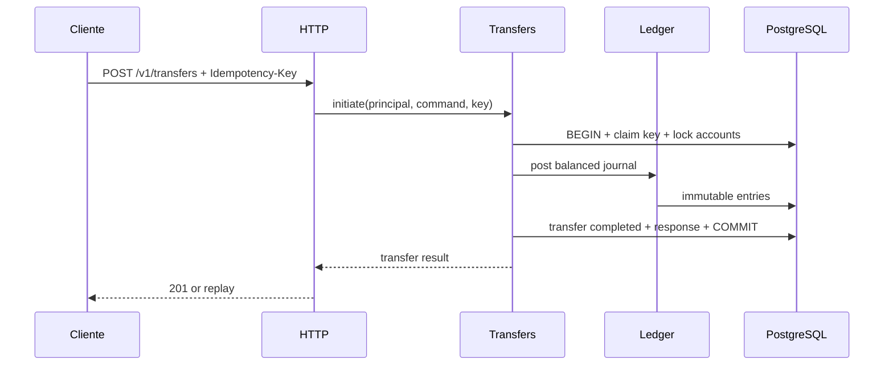

# Arquitetura — monólito modular hexagonal

## Decisão
Um **deploy Spring Boot** e **um PostgreSQL**, com schemas ou ownership de tabelas por módulo. Sem HTTP interno entre módulos. Infraestrutura do monólito não é sinônimo de ausência de fronteiras.

## Módulos e responsabilidades
| Módulo | Responsabilidade | Quando |
|---|---|---|
| `identity` | principal autenticado e autorização (mock controlado inicial; real antes de expor API) | fase 0/1 |
| `accounts` | ciclo de vida e ownership de conta, consulta de extrato via contrato do ledger | fase 1 |
| `ledger` | journals imutáveis, saldo contábil, invariantes, reserva/projeções | fase 1 |
| `transfers` | orquestração de transferências internas e idempotência | fase 2 |
| `funding` | crédito fictício de testes por contrapartida contábil; só perfil dev/test | fase 1 |
| `outbox` | persistência e publicação confiável de eventos | fase 3 |
| `pix-simulator` | dispositivo externo simulado, via adaptador, falhas controladas | fase 4 |
| `payments` | autorização/captura/estorno simulado de cartão tokenizado | fase 5 |
| `notifications`, `fraud`, `reconciliation` | projeções, sinais e confrontação de dados | fases 3–6 |

## Camadas por módulo
```text
com.hexbank
  accounts/
    domain/                   # entidades, objetos de valor, regras puras
    application/
      port/in/                # casos de uso
      port/out/               # interfaces para persistência/outros módulos
      service/                # orquestração
    adapter/in/http/          # REST e validações de transporte
    adapter/out/persistence/  # JPA/JDBC/Postgres
    config/                   # composition root local
  ledger/...
  transfers/...
  shared/
    domain/                   # shared kernel mínimo: Money, InstanceCurrency
    adapter/in/http/          # tipos técnicos comuns (erro problem+json, request id)
  bootstrap/                  # aplicação e wiring
```

**Regra de dependência:** `adapter -> application -> domain`. Domínio não conhece framework. Cada módulo publica pequena API Java explícita (`port/in` ou facade pública). **Não** importar JPA entities, repositórios ou tabelas privadas de outro módulo. Proibir ciclos com ArchUnit; Spring Modulith pode complementar.

## Shared kernel (`shared/domain`)
Tipos de domínio usados por vários módulos e sem dono natural. Hoje: **`Money` e `InstanceCurrency`** (enum com as moedas suportadas; só `BRL` no MVP). Na Fase 1 entram também `IdempotencyKey` e `AuditEntry` com sua porta de saída (ver "Tipos comuns da Fase 1 em `shared`").

- **Por que não no `ledger`:** `accounts`, `transfers` e `funding` também usam `Money`. Com o tipo no ledger, todo módulo dependeria do ledger só por um objeto de valor, e o ledger nunca poderia depender de nenhum deles sem criar ciclo.
- **Entra:** objetos de valor imutáveis, estáveis e sem regra específica de um módulo.
- **Não entra:** IDs de módulos (`AccountId`, `JournalId`, `TransferId`), regras de saldo (BR-016 é do ledger), entidades, portas ou qualquer dependência de framework.
- **Regra de dependência:** `shared` não depende de nenhum módulo (`accounts`, `ledger`, ...). Verificado por `ArchitectureTest.sharedDoesNotDependOnModules`, junto da regra que mantém `..domain..` livre de framework.

### `Money` — o que deve fazer e respeitar
Regras de negócio: **[BR-001](../domain/BUSINESS_RULES.md#dinheiro-e-contas)** (moeda conhecida, sem overflow silencioso, sem `double`) e **[BR-052](../domain/BUSINESS_RULES.md#auditoria-e-estados)** (sempre unidade menor + moeda explícita). Uso no ledger: [ADR-0002](../adr/0002-convencao-contabil.md).

| Regra | Comportamento esperado |
|---|---|
| Representação | `InstanceCurrency` + `long minorUnits` (R$ 100,00 = `BRL` / `10000`). Nunca `double`/`float`; `BigDecimal` só na borda, se necessário |
| Moeda | apenas moedas de `InstanceCurrency` (`BRL` no MVP), garantido pelo tipo; moeda nula é rejeitada na criação |
| Imutável | operações devolvem novo `Money`; igualdade por valor (moeda + `minorUnits`) |
| Mesma moeda | somar, subtrair ou comparar moedas diferentes lança erro, nunca converte |
| Overflow | `Math.addExact`/`subtractExact`: overflow é exceção, nunca valor errado |
| Sinal | `Money` pode ser zero ou negativo como resultado de cálculo; **quem exige positivo é o chamador** (ex.: `JournalEntry` exige `> 0`, ADR-0002; transferência exige `amount > 0`, BR-020) |
| Sem arredondamento | não há divisão nem porcentagem no MVP; quando houver (taxas), entra por ADR com regra de arredondamento explícita |
| Serialização | API usa `{"currency":"BRL","minorUnits":10000}` ([HTTP_API.md](../contracts/HTTP_API.md)); a conversão para decimal é da UI |
| Domínio puro | sem Spring, JPA ou Jackson dentro do tipo; mapeamento fica nos adapters |

## Domínio do módulo `accounts`

### `Account` — o que deve fazer e respeitar
Regras de negócio: **[BR-002](../domain/BUSINESS_RULES.md#dinheiro-e-contas)** (id imutável, dono, moeda, status; só `ACTIVE` movimenta), **[BR-004](../domain/BUSINESS_RULES.md#dinheiro-e-contas)** (dono vem do principal, não do payload) e **[BR-005](../domain/BUSINESS_RULES.md#dinheiro-e-contas)** (conta fechada não opera). Ciclo de vida: [ADR-0003](../adr/0003-ciclo-de-vida-e-encerramento-de-contas.md). Relação com o ledger: [ADR-0002](../adr/0002-convencao-contabil.md).

**O `Account` não guarda saldo.** Saldo é do ledger (BR-013); o `Account` cuida de identidade, dono, moeda e ciclo de vida.

**Estado**

| Campo | Tipo | Regra |
|---|---|---|
| `id` | `AccountId` (UUID) | imutável |
| `ownerId` | `PrincipalId` (`identity/domain`) | imutável; vem do principal autenticado |
| `currency` | `InstanceCurrency` | imutável; a `LedgerAccount` da conta usa a mesma moeda |
| `status` | `ACTIVE` \| `BLOCKED` \| `CLOSED` | muda só por transição permitida |
| `createdAt` | `Instant` UTC | definido na criação |
| `closedAt` | `Instant` opcional | preenchido **se e somente se** `status = CLOSED` |

**Comportamento**

| Regra | Comportamento esperado |
|---|---|
| Criação | fábrica (ex.: `Account.open(id, ownerId, currency, now)`) cria sempre `ACTIVE`, `closedAt` nulo; nenhum campo obrigatório nulo |
| Dono | `isOwnedBy(PrincipalId)` para a BR-004; negar acesso é decisão do caso de uso |
| Exigir ativa | `requireActive()` lança `AccountNotActiveException` (`409 ACCOUNT_NOT_ACTIVE`) se não `ACTIVE`; usado por funding e transferência (origem **e** destino) |
| Bloquear / desbloquear | `block()`: `ACTIVE → BLOCKED`; `unblock()`: `BLOCKED → ACTIVE` |
| Encerrar | `close(now)`: `ACTIVE`/`BLOCKED → CLOSED`, preenche `closedAt` |
| Idempotência | transição para o status atual não faz nada e não falha |
| `CLOSED` terminal | qualquer transição a partir de `CLOSED` lança `InvalidStatusTransitionException` (`409 INVALID_STATUS_TRANSITION`) |
| Exceções | `AccountNotActiveException` e `InvalidStatusTransitionException` estendem `BusinessException`, em `accounts/domain` |
| Domínio puro | sem Spring, JPA ou Jackson; mapeamento fica nos adapters |

**Não é responsabilidade do `Account`**

- **Saldo e conciliação:** encerrar exige saldo zero e nenhum hold ativo (ADR-0003), mas quem verifica é o **caso de uso**, consultando o ledger pela porta pública na mesma transação. `Account.close()` só valida a transição.
- **Autorização por papel:** "só admin bloqueia" e "titular não encerra conta `BLOCKED`" ficam no caso de uso, porque dependem de papéis do `identity`.
- **Criar a `LedgerAccount`:** o caso de uso de abertura cria `Account` e `LedgerAccount` `LIABILITY` na mesma transação (ADR-0002, `UNIQUE(account_id)`).

**Escopo na Fase 1:** mínimo `open`, `isOwnedBy` e `requireActive`. `block`, `unblock` e `close` podem esperar os endpoints, mas as regras do ADR-0003 já valem no domínio e são baratas de implementar e testar agora.

### `AccountId`
`record` com `UUID` não nulo, em `accounts/domain`. Só o módulo `accounts` usa este tipo; para os outros módulos o id da conta é um `UUID` puro (ver "Dependências entre módulos na Fase 1").

### Casos de uso de `accounts`

**Abrir conta** (`POST /v1/accounts`, [HTTP_API](../contracts/HTTP_API.md#criar-conta-fase-1))

| Regra | Comportamento esperado |
|---|---|
| Dono | `ownerId` = `PrincipalId` autenticado; o corpo não tem `ownerId` (BR-004) |
| Moeda | texto do corpo convertido para `InstanceCurrency`; desconhecida → `400 INVALID_REQUEST` (BR-001) |
| Várias contas | o mesmo dono pode ter várias contas (o `DATA_MODEL` só prevê índice por owner, sem unique) |
| Atomicidade | **uma transação**: `Account` `ACTIVE` + `LedgerAccount` `LIABILITY` na mesma moeda + projeção zerada + auditoria `ACCOUNT_CREATED` |
| Resposta | `201` com `id`, `currency`, `status` |

**Consultar conta e saldo** (`GET /v1/accounts/{id}` e `/balance`)

| Regra | Comportamento esperado |
|---|---|
| Acesso | só o dono (BR-004); conta de outro dono ou inexistente → `404 ACCOUNT_NOT_FOUND` (não `403`, para não revelar que existe) |
| Status | consulta funciona em qualquer status (ADR-0003) |
| Saldo | `bookedMinorUnits`, `reservedMinorUnits`, `availableMinorUnits` e `asOf`, lidos da projeção do ledger pela porta pública; o `accounts` não calcula saldo |
| Formato | valores em unidade menor + moeda explícita (BR-052) |

## Domínio do módulo `ledger`
Regras de negócio: **[BR-010 a BR-016](../domain/BUSINESS_RULES.md#ledger)**. Convenção contábil: **[ADR-0002](../adr/0002-convencao-contabil.md)**, que tem precedência sobre esta seção em caso de dúvida.

### `LedgerAccountType` e `EntrySide`

| Regra | Comportamento esperado |
|---|---|
| Tipos | `ASSET`, `LIABILITY`, `EQUITY` no MVP (`INCOME`/`EXPENSE` só por ADR) |
| Lados | `EntrySide` = `DEBIT` \| `CREDIT` |
| Saldo normal | `type.normalBalance()`: `ASSET → DEBIT`; `LIABILITY` e `EQUITY → CREDIT`. Derivado, nunca informado |
| Delta | `+valor` se o lado do entry é o saldo normal da conta, `−valor` caso contrário (ADR-0002, seção 5) |

### `LedgerAccount`

| Campo | Tipo | Regra |
|---|---|---|
| `id` | `LedgerAccountId` (UUID) | imutável |
| `accountId` | `UUID` opcional | conta de cliente; nulo em conta institucional; único (`UNIQUE(account_id)`) |
| `code` | texto opcional | conta institucional (ex.: `SIMULATED_CASH:BRL`); nulo em conta de cliente; único |
| `currency` | `InstanceCurrency` | imutável |
| `type` | `LedgerAccountType` | **imutável** (erro de tipo inverte lançamentos, ADR-0002) |

| Regra | Comportamento esperado |
|---|---|
| Exatamente um vínculo | ou `accountId` ou `code`, nunca os dois e nunca nenhum |
| Conta de cliente | fábrica `forCustomer(id, accountId, currency)` cria sempre `LIABILITY` |
| Conta institucional | fábrica `institutional(id, code, type, currency)`; no MVP só existe `SIMULATED_CASH:BRL` (`ASSET`), criada pela `V3__ledger.sql` com UUID fixo |
| Saldo negativo | `allowsNegativeAvailable()`: `false` para cliente, `true` para institucional (BR-016) |
| Sem status | não tem status nem conhece o status da conta (ADR-0003) |

### `JournalEntry`

| Regra | Comportamento esperado |
|---|---|
| Campos | `ledgerAccountId`, `side`, `amount` (`Money`) |
| Valor | `amount.isPositive()` obrigatório; zero ou negativo é rejeitado (ADR-0002, seção 1) |
| Moeda | moeda do `amount` = moeda da `LedgerAccount`; verificado ao lançar, quando a conta é carregada |
| Imutável | sem setters; nunca UPDATE/DELETE (BR-011) |

### `Journal`

| Regra | Comportamento esperado |
|---|---|
| Campos | `id` (`JournalId`), `referenceType`, `referenceId` (UUID), `createdAt`, `reversalOf` opcional, `entries` |
| Referência | `referenceType` ∈ `FUNDING`, `TRANSFER` (Fase 2), `REVERSAL`; par `(referenceType, referenceId)` único (BR-012) |
| Mínimo de entries | `≥ 2` (BR-010) |
| Balanceado | Σ débitos = Σ créditos, somados com `Money.plus` (overflow vira exceção) (BR-010) |
| Uma moeda | todos os entries na mesma moeda (MVP rejeita journal multimoeda) |
| Conta repetida | a mesma `LedgerAccount` não aparece em dois entries do mesmo journal (débito e crédito na mesma conta é lançamento vazio) |
| Imutável | lista de entries copiada na criação e exposta só para leitura (BR-011) |
| Estorno | `reverse(newId, now)` gera journal novo com `reversalOf = id`, `referenceType = REVERSAL`, `referenceId = id`, mesmas contas e valores, lados invertidos. Estornar um estorno é proibido; no máximo um estorno por original (`UNIQUE(reversal_of)`) |
| Validação | tudo validado no construtor/fábrica: um `Journal` inválido não existe |

Journal desbalanceado, multimoeda ou com entry inválido indica **bug do chamador**, não erro do cliente: vira exceção de domínio mapeada para `500 INTERNAL_ERROR`, nunca `4xx`.

### `BalanceProjection`

| Regra | Comportamento esperado |
|---|---|
| Campos | `ledgerAccountId`, `booked` e `reserved` (`Money`), `version` |
| Criação | toda `LedgerAccount` nasce com projeção zerada, na mesma transação |
| Aplicar entry | `booked = booked.plus(delta)` com o delta do saldo normal (ADR-0002) |
| Disponível | `available = booked − reserved` (BR-014) |
| Nunca negativo | se a conta **não** `allowsNegativeAvailable()` e `available < 0` após aplicar, lança `InsufficientFundsException` (`409 INSUFFICIENT_FUNDS`) e nada é gravado (BR-016) |
| Reservado | `reserved ≥ 0`; na Fase 1 é sempre zero (holds entram na Fase 4) |
| Transação | atualizada na **mesma transação** do journal; `version` para atualização condicional (BR-013, BR-022) |
| Verificável | projeção = recomputação a partir dos entries, para toda conta (teste de integração, ADR-0002 seção 6) |

Na Fase 1 o funding só credita conta de cliente, então `INSUFFICIENT_FUNDS` não acontece ainda. A regra já existe para a Fase 2.

### API pública do ledger (`application/port/in`)

| Caso de uso | Regra |
|---|---|
| Abrir conta contábil de cliente | recebe `accountId` (UUID) e moeda; cria `LedgerAccount` `LIABILITY` + projeção zerada. Chamado por `accounts` na abertura |
| Lançar journal | recebe referência e entries; **numa transação** carrega as contas, valida moeda, grava journal + entries e aplica as projeções. Trava as projeções em ordem estável de `LedgerAccountId` (BR-022) |
| Consultar saldo | por `accountId` (UUID): `booked`, `reserved`, `available` e `asOf` |
| Conta institucional | localizar por `code` (ex.: `SIMULATED_CASH:BRL`) |

O ledger **não** verifica status de conta nem autorização: isso é do caso de uso que chama (ADR-0003).

## Domínio do módulo `funding`
Regras de negócio: **[BR-003](../domain/BUSINESS_RULES.md#dinheiro-e-contas)**. Contrato: [HTTP_API](../contracts/HTTP_API.md#funding-de-laboratório-fase-1-apenas-dev--test). Lançamento de referência: [ADR-0002](../adr/0002-convencao-contabil.md), seção 4.

### Funding fictício (`POST /v1/dev/funding`)

| Regra | Comportamento esperado |
|---|---|
| Ambiente | só existe em `dev`/`test`: `@Profile` no controller **e** papel `TEST_ADMIN` (SECURITY.md regra 3) |
| Idempotency-Key | obrigatória, 16–128 caracteres, senão `400 INVALID_REQUEST`; **sem deduplicação na Fase 1** (repetir gera novo funding) |
| Valor | `amount.isPositive()`, senão `400 INVALID_REQUEST` |
| Moeda | moeda do `amount` = moeda da conta, senão `400 INVALID_REQUEST` |
| Conta | inexistente → `404 ACCOUNT_NOT_FOUND`; fora de `ACTIVE` → `409 ACCOUNT_NOT_ACTIVE` (verificado via porta de `accounts`, ADR-0003) |
| Lançamento | journal `FUNDING`, `referenceId` = id novo do funding: **DEBIT** `SIMULATED_CASH:<moeda>` / **CREDIT** conta do cliente, mesmo valor |
| Atomicidade | **uma transação**: checagem de status + journal + projeções + auditoria `FUNDING_POSTED` |
| Não é depósito | nunca roda fora de `dev`/`test`; não modela entrada de dinheiro real |

O `HTTP_API.md` ainda não define o status e o corpo da resposta do funding. Sugestão: `201` com `fundingId`, `journalId`, `accountId` e `amount`; registrar no contrato ao implementar.

## Tipos comuns da Fase 1 em `shared`

### `IdempotencyKey` (`shared/domain`)
Usado por `funding` (Fase 1) e `transfers` (Fase 2).

| Regra | Comportamento esperado |
|---|---|
| Formato | string opaca, 16–128 caracteres ([HTTP_API](../contracts/HTTP_API.md#convenções)); nula, vazia ou fora do tamanho é rejeitada na criação |
| Igualdade | por valor; sensível a maiúsculas/minúsculas |
| Sigilo | nunca vai para logs nem para o `audit_log` (ADR-0004) |
| Fase 1 | só valida; deduplicação por `(principal, operation, key)` entra na Fase 2 (BR-030 a BR-033) |

### `AuditEntry` e porta de auditoria
Regras: **[BR-050](../domain/BUSINESS_RULES.md#auditoria-e-estados)** e **[ADR-0004](../adr/0004-retencao-de-auditoria.md)**. O tipo e a porta de saída ficam em `shared` (`shared/domain` e `shared/application/port/out`), porque todos os módulos auditam; o adapter grava no schema `audit`.

| Regra | Comportamento esperado |
|---|---|
| Campos | `id`, `occurredAt` (UTC), `principalId`, `action`, `aggregateType`/`aggregateId`, `requestId`/`correlationId`; `fromStatus`/`toStatus` e `reason` opcionais |
| Ação | vocabulário fechado (enum): na Fase 1 `ACCOUNT_CREATED` e `FUNDING_POSTED` |
| Conteúdo | só identificadores e códigos: sem dados pessoais, payload, tokens, `Idempotency-Key` ou valores financeiros |
| Escrita | só inserção, na **mesma transação** do caso de uso; nunca UPDATE/DELETE |

## Dependências entre módulos na Fase 1

```text
identity ◀── accounts ──▶ ledger
                ▲            ▲
                └─ funding ──┘          (todos ──▶ shared)
```

- `accounts → identity`: usa `PrincipalId`.
- `accounts → ledger`: abre a conta contábil e consulta saldo.
- `funding → accounts`: verifica existência e status; `funding → ledger`: lança o journal.
- **O ledger não depende de nenhum módulo de negócio.** Por isso ele recebe o id da conta como `UUID` puro, e não `AccountId`: importar `AccountId` criaria `ledger → accounts` e, com `accounts → ledger`, um ciclo.

## Códigos de erro novos na Fase 1

| HTTP | `code` | Origem |
|---|---|---|
| 404 | `ACCOUNT_NOT_FOUND` | conta inexistente ou de outro dono |
| 409 | `ACCOUNT_NOT_ACTIVE` | `Account.requireActive()` |
| 409 | `INVALID_STATUS_TRANSITION` | transição proibida no `Account` (sem endpoint na Fase 1) |
| 409 | `INSUFFICIENT_FUNDS` | `BalanceProjection` (sem gatilho na Fase 1) |

Moeda desconhecida, valor não positivo, moeda divergente e `Idempotency-Key` inválida usam o `400 INVALID_REQUEST` que já existe.

## Fronteiras transacionais
- Transferência interna: uma transação ACID PostgreSQL cobre verificação/autorização, reserva ou débito, journal balanceado, transferência, idempotência e eventual outbox quando usada.
- Aplicação não chama API HTTP externa dentro de transação longa.
- Eventos assíncronos posteriores à persistência exigem **Outbox na mesma transação**; publicação via polling e retentativas, consumo idempotente.
- Evitar `REQUIRES_NEW` acidental separando lançamentos da operação; padronizar transações nas application services.

## Fluxos


## Evolução
1. Camada HTTP incorporada ao monólito.
2. Se necessário, adicionar reverse proxy/API Gateway externo para roteamento, autenticação de borda e rate limit. **Controles de autorização continuam em cada backend**.
3. Extrair serviço só com necessidade comprovada (deploy, escala, ownership). Antes: contrato estável, sem acesso cruzado a tabelas, eventos versionados, observabilidade e testes de contrato.
4. Ao extrair ledger/transfers, a atomicidade local deixa de existir: redesenhar fluxo transacional, não simplesmente trocar interface Java por HTTP.

## Não objetivos iniciais
Kubernetes, service discovery, service mesh, saga interna desnecessária, Kafka só por moda, Redis como fonte de saldo.
